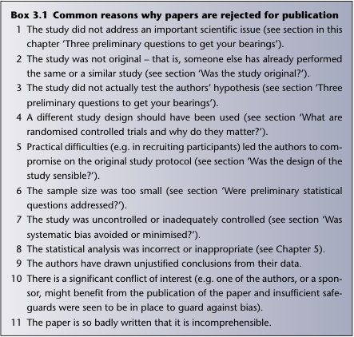
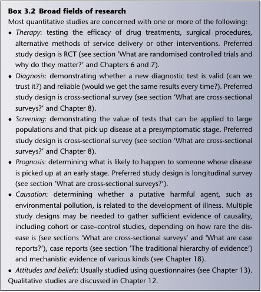
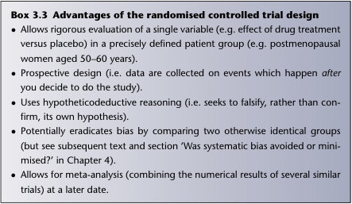
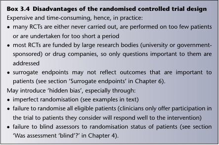

# 3. Getting your bearings: what is this paper about?
> Source attribution: [Source credits](../../SOURCE_CREDITS.md).

## PDF page 49 | printed page 30

### Getting your bearings: what is this paper about?

Chapter 3

The science of ‘trashing’ papers

It usually comes as a surprise to students to learn that some (some purists have claimed up to 99% of) published articles belong in the bin, and should certainly not be used to inform practice. In 1979, the editor of the British Medical Journal, Dr Stephen Lock, wrote ‘Few things are more dispiriting to a medical editor than having to reject a paper based on a good idea but with irremediable flaws in the methods used’. Fifteen years later, Altman was still claiming that only 1% of medical research was free of methodological flaws [1]; and in 2005 John Ioannidis published his classic, though controversial, paper, ‘Why most published research findings are false’ [2]. Box 3.1 shows the main flaws that lead to papers being rejected (and which are present to some degree in many that end up published). Most papers appearing in medical journals these days are presented more or less in standard introduction, methods, research and discussion (IMRAD) format: Introduction (why the authors decided to do this particular piece of research), Methods (how they did it, and how they chose to analyse their results), Results (what they found) and Discussion (what they think the results mean). If you are deciding whether a paper is worth reading, you should do so on the design of the methods section, and not on the interest value of the hypothesis, the nature or potential impact of the results or the speculation in the discussion. Conversely, bad science is bad science regardless of whether the study addressed an important clinical issue, whether the results are ‘statistically significant’, whether things changed in the direction you would have liked them to and whether the findings promise immeasurable benefits for patients or savings for the health service. Strictly speaking, if you are going to trash a paper, you should do so before you even look at the results.

How to Read a Paper: The Basics of Evidence-Based Healthcare, Seventh Edition. Trisha Greenhalgh and Paul Dijkstra. © 2025 John Wiley & Sons Ltd. Published 2025 by John Wiley & Sons Ltd.

## PDF page 50 | printed page 31

Box 3.1 Common reasons why papers are rejected for publication 1 The study did not address an important scientific issue (see section in this chapter ‘Three preliminary questions to get your bearings’). 2 The study was not original – that is, someone else has already performed the same or a similar study (see section ‘Was the study original?’). 3 The study did not actually test the authors’ hypothesis (see section ‘Three preliminary questions to get your bearings’). 4 A different study design should have been used (see section ‘What are randomised controlled trials and why do they matter?’). 5 Practical difficulties (e.g. in recruiting participants) led the authors to compromise on the original study protocol (see section ‘Was the design of the study sensible?’). 6 The sample size was too small (see section ‘Were preliminary statistical questions addressed?’). 7 The study was uncontrolled or inadequately controlled (see section ‘Was systematic bias avoided or minimised?’). 8 The statistical analysis was incorrect or inappropriate (see Chapter 5). 9 The authors have drawn unjustified conclusions from their data. 10 There is a significant conflict of interest (e.g. one of the authors, or a sponsor, might benefit from the publication of the paper and insufficient safeguards were seen to be in place to guard against bias). 11 The paper is so badly written that it is incomprehensible.

### Chapter 3

It is much easier to pick holes in other people’s work than to do a methodologically perfect piece of research oneself. But remember that scholarly critique is not the same as gratuitous criticism. There may be good practical reasons why the authors of the study have not performed a perfect study, and they know as well as you do that their work would have been more scientifically valid if this or that (anticipated or unanticipated) difficulty had not arisen during the course of the study. Most good scientific journals send papers out to one or more referees for comments on their scientific validity, originality and importance before deciding whether to publish them. This process is known as peer review, and much has been written about it [3]. Common defects picked up by referees are listed in Box 3.1. The assessment of methodological quality (critical appraisal) has been covered in detail in the widely cited series ‘Users’ Guides to the Medical Literature’ originally published in JAMA (the journal of the American Medical Association). JAMA’s structured guides on how to read papers on therapy, diagnosis, screening, prognosis, causation, quality of care,

Unmatched source image; PDF page 50. Consult the original caption.

## PDF page 51 | printed page 32

economic analysis, systematic review, qualitative research and so on are regarded by many as the definitive checklists for critical appraisal. Appendix 1 lists some simpler checklists we have derived from the Users’ Guides and the other sources cited at the end of this chapter, together with some ideas of our own. If you are an experienced journal reader, these checklists will be largely self-explanatory. But if you still have difficulty getting started when looking at a medical paper, try asking the preliminary questions in the next section.

Chapter 3

Three preliminary questions to get your bearings

Question one: Why was the study needed and what was the research question? The introductory sentence of a research paper should state, in a nutshell, what the background to the research is. For example, ‘One in ten children in UK has glue ear, and this condition is associated with significant delays in speaking and comprehension’. This statement should be followed by a brief review of the published literature; for example: ‘The benefit–harm balance of grommet insertion is disputed, since grommets involve a surgical procedure under anaesthetic. The grommet may provide only temporary relief before becoming blocked, and in most children, glue ear resolves spontaneously. Bone conduction headphones, which provide partial restoration of hearing while the condition resolves, may provide a noninvasive alternative to grommet insertion.’ It is irritatingly common for authors to forget to place their research in context, as the background to the problem is usually clear as daylight to them by the time they reach the writing-up stage. The last sentence of the introduction (or occasionally somewhere early in the methods section) should state clearly the research question and/or the hypothesis that the authors have decided to test. For example: ‘This study aimed to determine whether bone conduction headphones were more effective and safer than either immediate grommet insertion or watchful waiting’. You may find that the research question has inadvertently been omitted or, more commonly, that the information is buried somewhere mid-paragraph. If the main research hypothesis is presented in the negative (which it usually is), such as ‘The addition of pioglitazone to maximal dose metformin therapy will not improve the control of type 2 diabetes’, it is known as a null hypothesis. The authors of a study rarely actually believe their null hypothesis when they embark on their research. Being human, they have usually set out to demonstrate a difference between the two arms of their study. But the way scientists do this is to say ‘let’s assume there’s no difference; now let’s try to disprove that theory’. If you adhere to the teachings of philosopher of science

## PDF page 52 | printed page 33

Karl Popper, this hypotheticodeductive approach (setting up falsifiable hypotheses that you then proceed to test) is the very essence of the scientific method [4]. If you have not discovered what the authors’ research question was by the time you are halfway through the methods section, you may find it in the first paragraph of the discussion. Remember, however, that not all research studies (even good ones) are set up to test a single definitive hypothesis. Qualitative research studies, which (as long as they are well-designed and well-conducted) are as valid and as necessary as the quantitative studies beloved by most evidence-based healthcare enthusiasts, aim to look at particular issues in a broad, open-ended way to illuminate issues, generate or modify hypotheses and prioritise areas to investigate. This type of research is discussed further in Chapter 12. Even quantitative research (which most of the rest of this book is about) is now seen as more than hypothesis testing. In general, it is preferable to talk about evaluating the strength of evidence around a particular issue than about proving or disproving hypotheses.

Chapter 3

Question two: What was the research design? First, decide whether the paper describes a primary or secondary study. Primary studies report research first hand, while secondary studies attempt to summarise and draw conclusions from previously published primary studies. Primary studies (sometimes known as empirical studies) are the stuff of most published research in medical journals. They include laboratory experiments, which can help elucidate the causal mechanism for an observed effect (Chapter 18), clinical trials (randomised or otherwise; Chapter 6), longitudinal cohort studies, including the increasingly popular ‘big data’ designs and others using artificial intelligence (Chapter 17), validation studies (e.g. of a new diagnostic test; Chapter 8), surveys (e.g. of people’s attitudes; Chapter 13), qualitative research (e.g. to explore the patient’s experience of illness; Chapter 12), genetic association studies (Chapter 15) and mixed-method case studies or organisational change (Chapter 14). Secondary research includes various kinds of reviews, notably the systematic review (Chapter 9), which tries to cover all the literature on a particular topic in an objective and reproducible way. It also includes efforts to examine the costs of an intervention that has already been shown to be effective (Chapter 11), develop guidelines (Chapter 10) or reach consensus on a topic (Chapter 19).

Question three: Was the research design appropriate to the question? Examples of the sort of questions that can reasonably be answered by different types of primary research study are given in the sections that follow. One question that frequently cries out to be asked is this: was a randomised controlled trial (RCT) the best method of addressing this particular research

## PDF page 53 | printed page 34

Box 3.2 Broad fields of research Most quantitative studies are concerned with one or more of the following:

• • Therapy: testing the efficacy of drug treatments, surgical procedures,

alternative methods of service delivery or other interventions. Preferred study design is RCT (see section ‘What are randomised controlled trials and why do they matter?’ and Chapters 6 and 7).

### Chapter 3

• • Diagnosis: demonstrating whether a new diagnostic test is valid (can we trust it?) and reliable (would we get the same results every time?). Preferred study design is cross-sectional survey (see section ‘What are cross-sectional surveys?’ and Chapter 8). • • Screening: demonstrating the value of tests that can be applied to large populations and that pick up disease at a presymptomatic stage. Preferred study design is cross-sectional survey (see section ‘What are cross-sectional surveys?’ and Chapter 8). • • Prognosis: determining what is likely to happen to someone whose disease is picked up at an early stage. Preferred study design is longitudinal survey (see section ‘What are cross-sectional surveys?’). • • Causation: determining whether a putative harmful agent, such as

environmental pollution, is related to the development of illness. Multiple study designs may be needed to gather sufficient evidence of causality, including cohort or case–control studies, depending on how rare the disease is (see sections ‘What are cross-sectional surveys’ and ‘What are case reports?’), case reports (see section ‘The traditional hierarchy of evidence’) and mechanistic evidence of various kinds (see Chapter 18).

• • Attitudes and beliefs: Usually studied using questionnaires (see Chapter 13). Qualitative studies are discussed in Chapter 12.

question and, if the study was not an RCT, should it have been? Before you jump to any conclusions, decide what broad field of research the study covers (Box 3.2). Once you have done this, ask whether the study design was appropriate to this question.

### What are randomised controlled trials and why do they matter?

In an RCT, participants in the trial are randomly allocated by a process equivalent to the flip of a coin to either one intervention (such as a drug treatment) or another (such as placebo treatment or, more commonly, best current therapy). Both groups (formally known as ‘arms’) are followed up for a prespecified time period and analysed in terms of specific outcomes defined at the

Unmatched source image; PDF page 53. Consult the original caption.

## PDF page 54 | printed page 35

outset of the study (e.g. death, heart attack, serum cholesterol level). Because, on average, the groups are identical apart from the intervention, any differences in outcome are, in theory, attributable to the intervention. In reality, however, not every RCT is a bowl of cherries. Some papers that report trials comparing an intervention with a control group are not, in fact, randomised trials at all. The terminology for these is other controlled clinical trials – a term used to describe comparative studies in which participants were allocated to intervention or control groups in a nonrandom manner. This situation may arise, for example, when random allocation would be impossible, impractical or unethical; for example, when patients on ward A receive one diet while those on ward B receive a different diet. (Although this design is inferior to the RCT, it is much easier to execute, and was used successfully a century ago to demonstrate the benefit of brown rice over white rice in the treatment of beriberi [5].) The problems of nonrandom allocation are discussed further in section ‘Was systematic bias avoided or minimised?’ in relation to determining whether the two groups in a trial can reasonably be compared with one another on a statistical level. Some trials count as a sort of halfway house between true randomised trials and non-randomised trials. In these types, randomisation is not performed truly at random (e.g. using sequentially numbered sealed envelopes each with a computer-generated random number inside) but by some method that allows the clinician to know which group the patient would be in before they make a definitive decision to randomise the patient. This allows subtle biases to creep in, as the clinician might be more (or less) likely to enter a particular patient into the trial if they believed that this individual would get active treatment. In particular, patients with more severe disease may be subconsciously withheld from the placebo arm of the trial. Examples of unacceptable methods include randomisation by last digit of date of birth (even numbers to group A, odds to group B), toss of a coin (heads to group A, tails to group B), sequential allocation (patient A to group 1; patient B to group 2, etc.) and date seen in clinic (all patients seen this week to group A; all those seen next week to group 2, etc.; Box 3.3). Listed here are examples of clinical questions that would be best answered by an RCT, but note also the examples in the later sections of this chapter of situations where other types of studies could or must be used instead.

Chapter 3

•• Is this drug better than a placebo or a different drug for a particular disease? •• Is a new surgical procedure better than the currently favoured practice? •• Is a smartphone app offering cognitive behaviour therapy non-inferior to an in-person therapy from a psychologist in helping patients overcome phobia? (Note: many RCTs are designed not to demonstrate that a new, cheaper, treatment is superior to current practice, but merely that it is not inferior.)

## PDF page 55 | printed page 36

Box 3.3 Advantages of the randomised controlled trial design

• • Allows rigorous evaluation of a single variable (e.g. effect of drug treatment versus placebo) in a precisely defined patient group (e.g. postmenopausal women aged 50–60 years). • • Prospective design (i.e. data are collected on events which happen after you decide to do the study). • • Uses hypotheticodeductive reasoning (i.e. seeks to falsify, rather than confirm, its own hypothesis). • • Potentially eradicates bias by comparing two otherwise identical groups (but see subsequent text and section ‘Was systematic bias avoided or minimised?’ in Chapter 4). • • Allows for meta-analysis (combining the numerical results of several similar trials) at a later date.

### Chapter 3

RCTs are often said to be the gold standard in medical research. Up to a point, this is true (see section ‘The traditional hierarchy of evidence’) but only for certain types of clinical questions (see Box 3.2 and sections ‘Cohort studies’, ‘Case–control studies’, ‘Cross-sectional surveys’ and ‘Case reports’). The questions that best lend themselves to the RCT design all relate to interventions, and are mainly concerned with therapy or prevention. It should be remembered, however, that even when we are looking at therapeutic interventions, and especially when we are not, there are a number of important disadvantages associated with randomised trials (Box 3.4).

Box 3.4 Disadvantages of the randomised controlled trial design Expensive and time-consuming, hence, in practice:

• • many RCTs are either never carried out, are performed on too few patients or are undertaken for too short a period • • most RCTs are funded by large research bodies (university or government-

sponsored) or drug companies, so only questions important to them are addressed • • surrogate endpoints may not reflect outcomes that are important to patients (see section ‘Surrogate endpoints’ in Chapter 6). May introduce ‘hidden bias’, especially through:

• • imperfect randomisation (see examples in text)

• • failure to randomise all eligible patients (clinicians only offer participation in the trial to patients they consider will respond well to the intervention) • • failure to blind assessors to randomisation status of patients (see section ‘Was assessment ‘blind’?’ in Chapter 4).

Unmatched source image; PDF page 55. Consult the original caption.

Unmatched source image; PDF page 55. Consult the original caption.

## PDF page 56 | printed page 37

Remember, too, that the results of an RCT may have limited applicability as a result of selection bias (selection of trial participants from a group that is unrepresentative of everyone with the condition), uptake bias (limited interest in the study, or ability to participate in it, from certain key groups), performance bias (differences in what is provided to the groups over and above the intervention being tested), detection bias (differences between the groups in how the outcomes are assessed), attrition bias (when one group has many more withdrawals or ‘drop-outs’ than the other) and publication bias (selective publication of positive results, often but not always because the organisation that funded the research stands to gain or lose depending on the findings) [6]. These biases are discussed further in Chapter 4. Note also that analysis of only predefined ‘objective’ endpoints may exclude important qualitative aspects of the intervention (see Chapter 12) and may or may not include the outcomes that matter most to patients (see Chapter 16). Furthermore, RCTs can be well or badly managed [2] and, once published, their results are open to distortion by an over-enthusiastic scientific community or by a public eager for a new wonder drug. While all these problems might also occur with other trial designs, they may be particularly pertinent when an RCT is being sold to you as, methodologically speaking, whiter than white [7,8]. There are, in addition, many situations in which RCTs are unnecessary, impractical or inappropriate:

Chapter 3

•• RCTs are unnecessary:

◦◦when a clearly successful intervention for an otherwise fatal condition is discovered ◦◦when a previous RCT or meta-analysis has given a definitive result (either positive or negative). Arguably, it is actually unethical to ask patients to be randomised to a clinical trial without first conducting a systematic literature review to see whether the trial needs to be carried out at all. •• RCTs are impractical:

◦◦where the costs of a trial are unaffordable ◦◦where the number of participants needed to demonstrate a significant difference between the groups is prohibitively high. •• RCTs are inappropriate:

◦◦where the study is looking at the prognosis of a disease. For this analysis, the appropriate route to best evidence is a longitudinal survey of a properly assembled inception cohort ◦◦where the study is looking at the validity of a diagnostic or screening test. For this analysis, the appropriate route to best evidence is a crosssectional survey of patients clinically suspected of harbouring the relevant disorder

## PDF page 57 | printed page 38

◦◦where the study is looking at a ‘quality of care’ issue in which the criteria for ‘success’ have not yet been established. For example, an RCT comparing medical versus surgical methods of abortion might assess ‘success’ in terms of number of patients achieving complete evacuation, amount of bleeding and pain level. The patients, however, might decide that other aspects of the procedure are important, such as knowing in advance how long the procedure will take, not seeing or feeling the abortus come out, and so on. For this analysis, the appropriate route to best evidence is qualitative research methods (see Chapter 12).

Chapter 3

All these issues have been discussed in great depth by clinical epidemiologists and other scientists, who remind us that to turn our noses up at the non-randomised trial may indicate scientific naiveté and not, as many people routinely assume, intellectual rigour. You might also like to look up the emerging science of pragmatic RCTs – a methodology for taking account of practical, real-world challenges so that the findings of your trial will be more relevant to that real world when the trial is finished [9] (see also Chapter 6, where we introduce the Consolidated Standards of Reporting Trials statement, universally known as CONSORT, for presenting the findings of RCTs).

What are cohort studies?

In a cohort study, two (or more) groups of people are selected on the basis of differences in their exposure to a particular agent (such as a vaccine, a surgical procedure or an environmental toxin) and followed up to see how many in each group develop a particular disease, complication or other outcome. The follow-up period in cohort studies is generally measured in years (and sometimes in decades) because that is how long many diseases, especially cancer, take to develop. Note that RCTs are usually begun on people who already have a disease, whereas most cohort studies are begun on people who may or may not develop disease. A special type of cohort study may also be used to determine the prognosis of a disease (i.e. what is likely to happen to someone who has it). A group of people who have all been diagnosed as having an early stage of the disease or a positive screening test (see Chapter 7) is assembled (the inception cohort) and followed up on repeated occasions to see the incidence (new cases per year) and time course of different outcomes. (Here is a definition that you should commit to memory if you can: incidence is the number of new cases of a disease per year, whereas prevalence is the overall proportion of the population who suffer from the disease.) The world’s most famous cohort study, whose authors all won knighthoods, was undertaken by Sir Austen Bradford Hill, Sir Richard Doll and, latterly,

## PDF page 58 | printed page 39

Sir Richard Peto. They followed up 40 000 male British doctors divided into four cohorts (non-smokers, and light, moderate and heavy smokers) using both all-cause (any death) and cause-specific (death from a particular disease) mortality as outcome measures. Publication of their 10-year interim results in 1964 [10], which showed a substantial excess in both lung cancer mortality and all-cause mortality in smokers, with a ‘dose–response’ relationship (i.e. the more you smoke, the worse your chances of getting lung cancer), went a long way to demonstrating that the link between smoking and ill health was causal rather than coincidental. The 20-year [11], 40-year [12] and 50-year [13] results of this momentous study (which achieved an impressive 94% follow-up of those recruited in 1951 and not known to have died) illustrate both the perils of smoking and the strength of evidence that can be obtained from a properly conducted cohort study. Given here are clinical questions that should be addressed by a cohort study:

Chapter 3

•• Does smoking cause lung cancer? •• Does the contraceptive pill ‘cause’ breast cancer? Note, once again, that the word ‘cause’ is a loaded and potentially misleading term. As John Guillebaud argued in his excellent book, The Pill. . .[14], if a thousand women went on the oral contraceptive pill tomorrow, some of them would get breast cancer. But some of those would have got it anyway. The question that epidemiologists try to answer through cohort studies is, ‘what is the additional risk of developing breast cancer which this woman would run by taking the pill, over and above the baseline risk attributable to her own hormonal balance, family history, diet, alcohol intake, and so on?’. •• Does high blood pressure get better over time? •• What happens to infants who have been born very prematurely, in terms of subsequent physical development and educational achievement?

Since the first edition of this book appeared, cohort studies have undergone a quiet revolution, due partly to the exponential increase in computer power that has occurred in the past generation (and particularly the facility to link with electronic patient records; see Chapter 17 on ‘artificial intelligence’ (including big data studies) and partly to the emergence of population genetics (see Chapter 15). Whereas 20 years ago, respectability in research circles seemed to be based almost exclusively on whether one was currently conducting a randomised controlled trial and while such trials are still very important, these days, the well-dressed quantitative researcher is also expected to talk about their ‘cohort’, which is usually known by a catchy acronym and includes several thousand patients being followed up over time. Professor Richard Hobbs, for example, is a quantitative researcher based at

## PDF page 59 | printed page 40

the University of Oxford. His collection of cohorts includes OXVASC (around 10 000 people who have had an acute stroke), OXVALVE (6000 older people with screen-detected heart valve problems) and OXREN (3250 older people with chronic kidney disease). Google them to find out more!

Chapter 3

What are case–control studies?

In a case–control study, patients with a particular disease or condition are identified and ‘matched’ with controls (e.g. someone the same age and gender with some other disease, or no disease, randomly picked from a general practitioner’s list). Data are then collected (e.g. by searching back through these people’s medical records or by asking them to recall their own history) on past exposure to a possible causal agent for the disease. Like cohort studies, case–control studies are generally concerned with the aetiology of a disease (i.e. what causes it) rather than its treatment. They lie lower down the conventional hierarchy of evidence (in other words, they are a weaker form of evidence than RCTs or cohort studies), but this design is usually the only option when studying rare conditions – and it also offers options in genetic association studies (see Chapter 15). An important source of difficulty (and potential bias) in a case–control study is the precise definition of who counts as a ‘case’, because one misallocated individual may substantially influence the results (see section ‘Was systematic bias avoided or minimised?’). In addition, a case–control study cannot demonstrate causality; in other words, the association of A with B in a study of this design does not prove that A has caused B. Clinical questions that could be addressed by a case–control study include:

•• Does the prone sleeping position increase the risk of cot death (sudden infant death syndrome) in babies? •• Does whooping cough vaccine cause brain damage? •• Did eating at a particular pizza restaurant in a particular time period cause hepatitis A?

What are cross-sectional surveys?

We have probably all been asked to take part in a survey, even if it was only a person in the street asking us which brand of toothpaste we prefer. Surveys conducted by epidemiologists are run along essentially the same lines but more rigorously: a representative sample of participants is recruited and then interviewed, examined or otherwise studied to gain answers to a specific clinical (or other) question. In cross-sectional surveys, data are collected at a single time point but may refer retrospectively to health experiences in the

## PDF page 60 | printed page 41

past; for example, a survey of patients’ medical records to see how often their blood pressure has been recorded in the past 5 years. A cross-sectional survey should address the following clinical questions:

•• What is the ‘normal’ height of a 3-year-old child? This, like other questions about the range of normality, can be answered simply by measuring the height of enough healthy 3-year-olds. But such an exercise does not answer the related clinical question ‘when should an unusually short child be investigated for disease?’ because, as in almost all biological measurements, the physiological (normal) overlaps with the pathological (abnormal). This problem is discussed further in the section ‘Likelihood ratios’. •• What do psychiatric nurses believe about the value of antidepressant drugs and talking therapies in the treatment of severe depression? •• Is it true that ‘half of all cases of diabetes are undiagnosed’? This an example of the more general question, ‘What is the prevalence (proportion of people with the condition) of this disease in this community?’ The only way of finding the answer is to do the definitive diagnostic test on a representative sample of the population.

Chapter 3

What are case reports?

A case report describes the medical history of a single patient in the form of a story (‘Mrs B is a 54-year-old secretary who developed chest pain in June 2010. . .’). Case reports are often run together to form a case series, in which the medical histories of more than one patient with a particular condition are described to illustrate an aspect of the condition, the treatment or, most commonly these days, adverse reaction to treatment. Although this type of research is traditionally considered to be weak scientific evidence, a great deal of information that would be lost in a clinical trial or survey can be conveyed in a case report. In addition, case reports are immediately understandable by non-academic clinicians and by the lay public. They can, if necessary, be written up and published within days, which gives them a definite edge over clinical trials (whose gestation period can run into years) or meta-analyses (even longer). And the clinical case is the unit of learning (doctors learn medicine, and nurses nursing, by accumulating and reflecting on individual cases). There are certainly good theoretical grounds for the reinstatement of the humble case report as a useful and valid contribution to medical science, not least because the story is one of the best vehicles for making sense of a complex clinical situation. The following are clinical situations in which a case report or case series is an appropriate type of study.

## PDF page 61 | printed page 42

•• A doctor notices that two babies born in their hospital have absent limbs (phocomelia). Both mothers had taken a new drug (thalidomide) in early pregnancy. The doctor wishes to alert his colleagues worldwide to the possibility of drug-related damage as quickly as possible [15]. (Anyone who thinks ‘quick and dirty’ case reports are never scientifically justified should remember this example.) •• A patient who went undiagnosed with chronic pain and fatigue for years was subsequently found to be suffering from an unusual presentation of a rare disease. The team caring for her decide to write this story up as a lesson for other clinicians [16].

Chapter 3

The traditional hierarchy of evidence

As mentioned briefly in Chapter 2, standard notation for the relative weight carried by the different types of primary study when making decisions about clinical interventions (the ‘hierarchy of evidence’) puts them in the following order:

1. Systematic reviews and meta-analyses; 2. RCTs with definitive results (i.e. confidence intervals that do not overlap the threshold clinically significant effect; see section ‘Probability and confidence’) 3. RCTs with non-definitive results (i.e. a point estimate that suggests a clinically significant effect but with confidence intervals overlapping the threshold for this effect; see section ‘Probability and confidence’) 4. Cohort studies, including ‘big data’ studies, in which large numbers of people are followed using entries on their medical records; 5. Case–control studies 6. Cross-sectional surveys 7. Case reports.

The pinnacle of the hierarchy is, quite properly, reserved for secondary research papers, in which all the primary studies on a particular subject have been hunted out and critically appraised according to rigorous criteria (see Chapter 9). Note, however, that not even the most hard-line protagonist of EBM would place a sloppy meta-analysis or an RCT that was seriously methodologically flawed above a large, well-designed cohort study. And as Chapter 12 shows, many important and valid studies in the field of qualitative research do not feature in this particular hierarchy of evidence at all. In other words, evaluating the potential contribution of a particular study to medical science requires considerably more effort than is needed to check

## PDF page 62 | printed page 43

complex representation of the hierarchy of evidence geared to the domain of the question (therapy/prevention, diagnosis, harm, prognosis) was drawn up by a group of us in 2011 [17] and is available for download on the Centre for Evidence-Based Medicine website (https://www.cebm.ox.ac.uk/resources/ levels-of-evidence/ocebm-levels-of-evidence). But before you look up these more advanced tools, make sure you are clear on the traditional (basic) hierarchy described in this section. The take-home message is, don’t apply the hierarchy of evidence mechanically; it’s only a rule of thumb. In the next chapter, we go into more detail about how to assess the methodological quality of published papers.

Chapter 3

Exercises based on this chapter

1. In the opening section of this chapter, we suggested that if you are going to trash a paper, you should do so without even looking at the results section. When you have read through the rest of the chapter, list the arguments for assessing a paper’s merits on the basis of the research question, study design and methods (but not the results). 2. Which study design is most appropriate for answering the following kinds of question: a. Assessing the benefits of a treatment? b. Evaluating a diagnostic or screening test? c. Determining the course and prognosis of a disease? d. Determining whether a particular agent is likely to have a damaging effect? e. Measuring people’s attitudes to a topic? 3. List five different kinds of bias that can occur in randomised controlled trials. How would you try to reduce each of these?

References

1. Altman DG. The scandal of poor medical research. BMJ 1994; 308: 283. 2. Ioannidis, John PA. Why most published research findings are false. PLoS Medicine 2005; 2.8: e124. 3. Stahel PF, Moore. EE Peer review for biomedical publications: we can improve the system. BMC Medicine 2014; 12: 179. 4. Popper KR. The Logic of Scientific Discovery. Abingdon: Psychology Press; 2002. 5. Fletcher W. Rice and beriberi: preliminary report of an experiment conducted at the Kuala Lumpur Lunatic Asylum. Lancet 1907; 1: 1776. 6. Cochrane Collaboration. The Cochrane Handbook for Systematic Reviews of Interventions. Oxford: Cochrane Collaboration; 2022. https://training.cochrane. org/handbook (accessed 7 July 2023). 7. Kaptchuk TJ. The double-blind, randomized, placebo-controlled trial: gold stand-

## PDF page 63 | printed page 44

8. Greenhalgh T, Howick J, Maskrey N. Evidence-based medicine: a movement in crisis? BMJ 2014; 348: g3725. 9. Eldridge S. Pragmatic trials in primary health care: what, when and how? Family Practice 2010; 27: 591–2. 10. Doll R, Hill AB. Mortality in relation to smoking: ten years’ observations of British doctors. BMJ 1964; 1: 1399. 11. Doll R, Peto R. Mortality in relation to smoking: 20 years’ observations on male British doctors. BMJ 1976; 2: 1525. 12. Doll R, Peto R, Wheatley K, et al. Mortality in relation to smoking: 40 years’

### Chapter 3

observations on male British doctors. BMJ 1994; 309: 901–11. 13. Doll R, Peto R, Boreham J, et al. Mortality in relation to smoking: 50 years’

observations on male British doctors. BMJ 2004; 328: 1519. 14. Guillebaud J, MacGregor A. The Pill and other Forms of Hormonal Contraception. USA: Oxford University Press, 2009. 15. McBride WG. Thalidomide and congenital abnormalities. Lancet 1961; 2: 1358. 16. Cohen, S., & Markham, F. Ehlers–Danlos hypermobility type in an adult with chronic pain and fatigue: a case study. Clinical Case Reports 2017; 5: 1248–51. 17. Howick J, Chalmers I, Glasziou P, et al. The 2011 Oxford CEBM Levels of Evidence (Introductory Document). Oxford: Oxford Centre for Evidence-Based Medicine; 2011.
