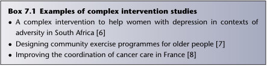

# 7. Papers that report trials of complex interventions
> Source attribution: [Source credits](../../SOURCE_CREDITS.md).

## PDF page 118 | printed page 99

### Papers that report trials of complex interventions

Chapter 7

Complex interventions

In Chapter 6, we defined a simple intervention (such as a drug) as one that is well demarcated (i.e. it is easy to say what the intervention comprises) and lends itself to an ‘intervention on’ versus ‘intervention off’ research design. A complex intervention is one that is not well demarcated (i.e. it is hard to say precisely what the intervention is) and which poses implementation challenges for researchers. Complex interventions generally involve multiple interacting components and may operate at more than one level (e.g. both individual and organisational) [1]. They include:

•• advice or education for patients •• education or training for health care staff •• interventions that seek active and ongoing input from the participant (e.g. physical activity, dietary interventions, lay support groups or psychological therapy delivered either face to face or online) •• a medical device or smartphone application that requires the patient to use it in a particular way and perhaps enter data to be sent remotely to the clinician •• organisational interventions intended to increase the uptake of evidence-

based practice (e.g. audit and feedback), which are discussed in more detail in a separate book, How to Implement Evidence-Based Healthcare [2].

Professor Penny Hawe and her colleagues [3] have argued that a complex intervention can be thought of as a ‘theoretical core’ (the components that make it what it is, which researchers must therefore implement faithfully) and additional non-core features that may (indeed, should) be adapted flexibly to local needs or circumstances. For example, if the intervention is providing feedback to doctors on how closely their practice aligns with an

How to Read a Paper: The Basics of Evidence-Based Healthcare, Seventh Edition. Trisha Greenhalgh and Paul Dijkstra. © 2025 John Wiley & Sons Ltd. Published 2025 by John Wiley & Sons Ltd.

## PDF page 119 | printed page 100

evidence-based hypertension guideline, the core of the intervention might be information on what proportion of patients in a given time period achieved the guideline’s recommended blood pressure level. The non-core elements might include how the information is given (orally, by letter and by email), whether the feedback is given as numbers or as a diagram, whether it is given confidentially or in a group-learning situation and so on. Complex interventions need to go through a development phase so that the different components can be optimised before being tested in a full-scale randomised controlled trial (RCT) [4]. Typically, there is an initial development phase of qualitative interviews or observations, and perhaps a small survey to find out what people would find acceptable, which feed into the design the intervention. This is followed by a small-scale pilot trial (effectively a ‘dress rehearsal’ for a full-scale trial, in which a small number of participants are randomised to see what practical and operational issues come up), and finally the full, definitive trial [1]. Here’s an example. One of Trisha’s research students, a doctor, wanted to study the impact of yoga classes on the control of diabetes. She initially spent some time interviewing people with diabetes and yoga teachers who worked with clients who had diabetes. She designed a small questionnaire to ask people with diabetes if they were interested in yoga, and found that some, but not all, were. All this was part of her development phase. The previous research literature on the therapeutic use of yoga gave her some guidance on core elements of the intervention; for example, there appeared to be good theoretical reasons why the focus should be on relaxation-type exercises rather than the more physically demanding strength or flexibility postures. The student’s initial interviews and questionnaires gave her a great deal of useful information, which she used to design the non-core elements of the yoga intervention. She knew, for example, that her potential participants were reluctant to travel very far from home, that they did not want to attend more than twice a week, that the subgroup most keen to try yoga were the recently retired (age 60–69 years) and that many potential participants described themselves as ‘not very bendy’ and were anxious not to overstretch themselves. All this information helped her design the detail of the intervention, such as who would do what, where, how often, with whom, for how long and using what materials or instruments. Disappointingly, when the carefully designed complex intervention was tested in an RCT, it had no impact on diabetes control compared with waiting list controls [5]. In the discussion section of the paper reporting the findings of the yoga trial, we offered two alternative interpretations. The first interpretation was that, contrary to previous non-randomised study findings, yoga has no effect on diabetes control. The second interpretation was that yoga may have an impact but despite our efforts in the development phase,

Chapter 7

## PDF page 120 | printed page 101

Box 7.1 Examples of complex intervention studies

• • A complex intervention to help women with depression in contexts of adversity in South Africa [6]

• • Designing community exercise programmes for older people [7]

• • Improving the coordination of cancer care in France [8]

the complex intervention was inadequately optimised. For example, many people found it hard to get to the group, and several people in each class did not do the exercises because they found them ‘too difficult’. Furthermore, while the yoga teachers put a great deal of effort into the twice-weekly classes and they gave people a tape and a yoga mat to take home, they did not emphasise to participants that they should practise their exercises every day. As we discovered, hardly any of the participants did any exercises at home. To optimise yoga as a complex intervention in diabetes, therefore, we might consider measures such as: (1) getting a doctor or nurse to ‘prescribe’ it, so that the patient is more motivated to attend every class; (2) working with the yoga teachers to design special exercises for older, under-confident people who cannot follow standard yoga exercises and (3) stipulating more precisely what is expected as ‘homework’. This example shows that when a trial of a complex intervention produces negative results, this does not necessarily prove that all adaptations of this intervention will be ineffective in all settings. Rather, it tends to prompt the researchers to go back to the drawing board and ask how the intervention can be further refined and adapted to make it more likely to work. Note that because our yoga intervention needs more work, we did not go on directly to a full-scale RCT but returned to the development phase to try to refine the intervention. Box 7.1 shows some examples of recently published complex intervention studies. Not included in that list (or this chapter) are studies of artificial intelligence interventions, which are covered in Chapter 17.

Chapter 7

Ten questions to ask about a paper describing a complex intervention

The Medical Research Council (MRC) has published a framework in the BMJ for developing and evaluating complex interventions [1]. The questions given later, about how to appraise a paper describing a complex intervention, are based on this MRC framework and other methodological studies [9, 10]. See also the 2017 extension of the CONSORT statement to include nonpharmacological treatments [11].

Unmatched source image; PDF page 120. Consult the original caption.

## PDF page 121 | printed page 102

Question one: What is the problem for which this complex intervention is seen as a possible solution? It is all too easy to base a complex intervention study on a series of unquestioned assumptions. Teenagers drink too much alcohol and have too much unprotected sex, so surely educational programmes are needed to tell them about the dangers of this behaviour? This does not follow, of course! The problem may be teenage drinking or sexual risk-taking, but the underlying cause of that problem may not be ignorance but (for example) peer pressure and messages from the media. By considering precisely what the problem is, you will be able to look critically at whether the intervention has been (explicitly or inadvertently) designed around an appropriate theory of action (see question 4).

Question two: What was done in the developmental phase of the research to inform the design of the complex intervention? There are no fixed rules about what should be done in a developmental phase, but the authors should state clearly what they did and justify it. If the developmental phase included qualitative research (this is usually the case), see Chapter 12 for detailed guidance on how to appraise such papers. If a questionnaire was used, see Chapter 14. When you have appraised the empirical work using checklists appropriate to the study design(s), consider how these findings were used to inform the design of the intervention. The design of the intervention will probably need to be informed by both qualitative and quantitative data; how to bring these different sources together is a complex challenge which is covered elsewhere [6].

Chapter 7

Question three: What were the core and non-core components of the intervention? To put this question another way: (1) what are the things that should be standardised so they remain the same wherever the intervention is implemented? And (2) what are the things that should be adapted to context and setting [3]? The authors should state clearly which aspects of the intervention should be standardised and which should be adapted to local contingencies and priorities. An under-standardised complex intervention may lead to a paucity of generalisable findings; an over-standardised one may be unworkable in some settings and hence, overall, an underestimate of the potential effectiveness of the core elements. The decision as to what is ‘core’ and what is ‘non-core’ should be made on the basis of the findings of the developmental phase. Remember to unpack the control intervention in just as much detail as you unpack the experimental one. If the control was ‘nothing’ (or waiting list), describe what the participants in the control arm of the trial will not be

## PDF page 122 | printed page 103

receiving compared with those in the intervention arm. More likely, the control group will receive a package that includes (for example) an initial assessment, some review visits, some basic advice and perhaps a leaflet or helpline number. Defining what the control group is offered will be particularly important if the trial addresses a controversial and expensive new care package. In a trial of telehealth known as the Whole Systems Demonstrator, the findings were interpreted by some commentators as showing that telehealth installed in people’s homes leads to significantly lower use of hospital services and improved survival rates (albeit at high cost per case) [12]. However, the intervention group actually received a combination of two interventions: the telehealth equipment and regular phone calls from a nurse. The control group received no telehealth equipment – but no phone calls from the nurse either. Perhaps it was the human contact, not the technology, that made the difference. Frustratingly, we cannot know. Arguably, the control group should have received the phone calls too!

Chapter 7

Question four: What was the theoretical mechanism of action of the intervention? The authors of a study on a complex intervention should state explicitly how the intervention is intended to work, including how the different components fit together. This statement is likely to change as the results of the developmental phase are analysed and incorporated into the refinement of the intervention. It is not always obvious why an intervention works (or why it fails to work), especially if it involves multiple components aimed at different levels (e.g. individual, family and organisation). A few years ago, Trisha’s team reviewed the qualitative sections of research trials on school-based feeding programmes for disadvantaged children [13]. In 19 studies, all of which had tested this complex intervention in an RCT (see the linked Cochrane review and meta-analysis [14]), we found a total of six different mechanisms by this intervention may have improved nutritional status, school performance or both: long-term correction of nutritional deficiencies; short-term relief of hunger; the children felt valued and looked after; reduced absenteeism; improved school diet inspired improved home diet and improved literacy in one generation improved earning power and hence reduced the risk of poverty in the next generation. When critically appraising a paper on a complex intervention, you will need to make a judgement on whether the mechanisms offered by the authors are plausible and adequate. Common sense is a good place to start here, as is discussion among a group of experienced clinicians and service users. You may have to deduce the mechanism of action indirectly if the authors did not

## PDF page 123 | printed page 104

state it explicitly. A review a few years ago by Grol and Grimshaw [15] showed that only 27% of studies of implementing evidence included an explicit theory of change.

Question five: What outcome measures were used and were they sensible? With a complex intervention, a single outcome measure may not reflect all the important effects that the intervention may have. While a trial of a drug against placebo in diabetes would usually have a single primary outcome measure (typically the HbA1c blood test) and perhaps two or three secondary outcome measures (such as body mass index, overall cardiovascular risk and quality of life), a trial of an educational intervention may have multiple outcomes, all of which are important in different ways. In addition to markers of diabetic control, cardiovascular risk and quality of life, it would be important to know whether staff found the educational intervention acceptable and practicable to administer, whether people showed up to the sessions, whether the participants’ knowledge changed, whether they changed their self-care behaviour, whether the organisation became more patient-centred, whether calls to a helpline increased or decreased, and so on. When you have answered questions one to five, you should be able to express a summary so far in terms of population, intervention, comparison and outcome, although this is likely to be less succinct than an equivalent summary for a simple intervention. Now, let’s turn to the results section of the paper.

Chapter 7

Question six: What were the findings? Note, from question five, that a complex intervention may have significant impact on one set of outcome measures but no significant impact on other measures. Findings such as these need careful interpretation. Trials of selfmanagement interventions (in which people with chronic illness are taught to manage their condition by altering their lifestyle and titrating their medication against symptoms or home-based tests of disease status) are widely considered to be effective. In fact, such programmes rarely change the underlying course of the disease or make people live longer – they just make people feel more confident in managing their illness [16,17]! Sometimes, however, researchers produce a complex intervention that does improve ‘hard’ outcomes like disease severity. For example, Hilary Pinnock and her team showed that, in relation to self-management interventions for asthma, improvements in both disease severity and quality of life are possible if self-management education is accompanied by two things: addition of a personalised action plan and regular professional

## PDF page 124 | printed page 105

review [18]. If that intervention sounds complex, it is – but that’s the reality of changing behaviour.

Question seven: What process evaluation was done and what were the key findings? In particular, to what extent was the intervention implemented as planned (‘implementation fidelity’)? A process evaluation is a (mostly) qualitative study carried out in parallel with an RCT, which collects information on the practical challenges faced by front-line staff trying to implement the intervention [1,9,10,19]. In our study of yoga in diabetes, for example, researchers (one of whom was a medical student doing a BSc project) sat in on the yoga classes, interviewed patients and staff, collected the minutes of planning meetings and generally asked the question ‘How’s it going?’ [5]. One key finding from this was the inappropriateness of some of the venues. Only by actually being there when the yoga class was happening could we have discovered that it’s impossible to relax and meditate in a public leisure centre with regular announcements over a very loud intercom! Process evaluations should determine whether the intervention was implemented as planned (‘fidelity’) or if compromises were made (e.g reducing the intensity of contact) [20]. They will also capture the views of participants and staff about how to refine the intervention and/or why it may not be working as planned.

Chapter 7

Question eight: If the findings were negative, to what extent can this be explained by implementation failure and/or inadequate optimisation of the intervention? This question follows on from the process evaluation. In Trisha’s review of school-based feeding programmes (see question 4), many studies had negative results and, on reading the various papers, the review team came up with a number of explanations why school-based feeding might not improve either growth or school performance [13]. For example, the food offered may not have been consumed, or it provided too little of the key nutrients; the food consumed may have had low bioavailability in undernourished children (e.g. it was not absorbed because their intestines were swollen and damaged); there may have been a compensatory reduction in food intake outside school (e.g. the evening meal was given to another family member if the child was known to have been fed at school); supplementation may have occurred too late in the child’s development or the programme may not have been implemented as planned (e.g. in one study, some of the control group were given food supplements because front-line staff felt, probably rightly, that it was unethical to give food to half the hungry children in a class but not the other half).

## PDF page 125 | printed page 106

Question nine: If the findings varied across different subgroups, to what extent have the authors explained this by refining their theory of change? Did the intervention improve the outcomes in women but not in men? In highly educated affluent people with good Internet access but not in lesseducated, less well-off people with poor or no Internet access? In primary care settings but not in secondary care? Or in Manchester but not in Delhi? If so, ask why. This ‘why’ question is another judgement call, because it’s a matter of interpreting findings in context. In general, ‘why’ questions can’t be answered purely by applying a technical algorithm or checklist. Look in the discussion section of the paper and you should find the authors’ explanation of why subgroup X benefited but subgroup Y didn’t. They should also have offered a refinement of their theory of change that takes account of these differences. For example, the studies of school feeding programmes we reviewed a few years ago showed (overall) statistically greater benefit in younger children, which led the authors of these studies to suggest that there is a critical window of development, after which even nutritionally rich supplements have limited impact on growth or performance [13,14].

Chapter 7

Question ten: What further research do the authors believe is needed and is this belief justified? As you will know if you have read this chapter up to this point, complex interventions are multifaceted, nuanced and impact on multiple different outcomes. Authors who present studies of such interventions have a responsibility to tell us how their study has shaped the overall research field. They should not conclude merely that ‘more research is needed’ (an inevitable follow-on from any scientific study) but they should indicate where research efforts might best be focused. Indeed, one of the most useful conclusions might be a statement of the areas in which further research is not needed! The authors should state, for example, whether the next stage should be new qualitative research, a new and bigger RCT or further analysis of data already gathered.

Exercises based on this chapter

1. Before you look up any literature, design a complex intervention to

promote smoking cessation in pregnant women. Remember that smoking is more prevalent in poor, disadvantaged (e.g. homeless) and some minority ethnic groups (who may not be fluent in English). When you have designed your intervention, do a literature search to find studies of actual interventions. What did the researchers do? What was their theory of change? What did they find – and what explains these findings?

## PDF page 126 | printed page 107

2. Design a complex intervention to improve the quality of education for a clinical group (doctors, nurses, midwives and so on). Think about how you might intervene to change the behaviour of both students and teachers. What is your theory of change? What initial qualitative work might you do to develop your intervention? What would be the core features of your intervention? If you were going to test this intervention in an RCT, what would your control intervention be and what would your process evaluation look like? 3. Think about a non-drug intervention such as education, psychotherapy or patient use of apps. Hunt out some RCTs of interventions you’re thinking of using yourself (or recommending to patients). Describe both the ‘core’ and ‘non-core’ elements of the intervention. Apply the CONSORT checklist for non-drug interventions to evaluate the study’s quality [11].

### References

### Chapter 7

1. Skivington K, Matthews L, Simpson SA, et al. A new framework for developing and evaluating complex interventions: update of Medical Research Council guidance. BMJ 2021; 374, n2061. 2. Greenhalgh T. How to Implement Evidence-Based Healthcare. Oxford: Wiley-

Blackwell; 2018. 3. Hawe P, Shiell A, Riley T. Complex interventions: how ‘out of control’ can a

randomised controlled trial be? BMJ 2004; 328(7455): 1561–3. 4. O’Cathain A, Croot L, Duncan E, et al. Guidance on how to develop complex

interventions to improve health and healthcare. BMJ Open 2019; 9(8): e029954. 5. Skoro-Kondza L, Tai SS, Gadelrab R, et al. Community based yoga classes for type 2 diabetes: an exploratory randomised controlled trial. BMC Health Services Research 2009; 9(1): 33. 6. Burgess RA, Jeske N, Rasool S, et al. Exploring the impact of a complex intervention for women with depression in contexts of adversity: a pilot feasibility study of COURRAGE-plus in South Africa. International Journal of Social Psychiatry 2022; 68(4): 873–80. 7. Bird ML, Mortenson WB, Eng JJ. Evaluation and facilitation of intervention fidelity in community exercise programs through an adaptation of the TIDier framework. BMC Health Services Research 2020; 20: 68. 8. Colombani F, Sibé M, Kret M, et al. EPOCK study protocol: a mixed-methods research program evaluating cancer care coordination nursing occupations in France as a complex intervention. BMC Health Services Research 2019; 19: 483. 9. Noyes J, Booth A, Moore G, et al. Synthesising quantitative and qualitative

evidence to inform guidelines on complex interventions: clarifying the purposes, designs and outlining some methods. BMJ Global Health 2019; 4(Suppl 1): e000893.

## PDF page 127 | printed page 108

10. Paparini S, Papoutsi C, Murdoch J, et al. Evaluating complex interventions in context: systematic, meta-narrative review of case study approaches. BMC Medical Research Methodology 2021; 21: 225. 11. Boutron I, Altman DG, Moher D, et al. CONSORT statement for randomized trials of nonpharmacologic treatments: a 2017 update and a CONSORT extension for nonpharmacologic trial abstracts. Annals of Internal Medicine 2017;167: 40–47Schulz. 12. Steventon A, Bardsley M, Billings J, et al. Effect of telehealth on use of secondary care and mortality: findings from the Whole System Demonstrator cluster randomised trial. BMJ 2012; 344: e3874. 13. Greenhalgh T, Kristjansson E, Robinson V. Realist review to understand the efficacy of school feeding programmes. BMJ 2007; 335: 858–61. 14. Kristjansson EA, Robinson V, Petticrew M, et al. School feeding for improving the physical and psychosocial health of disadvantaged elementary school children. Cochrane Database of Systematic Reviews 2007; (1): CD004676. 15. Grol R, Grimshaw J. From best evidence to best practice: effective implementation of change in patients’ care. Lancet 2003; 362: 1225–30. 16. Foster G, Taylor S, Eldridge S, et al. Self-management education programmes by lay leaders for people with chronic conditions. Cochrane Database of Systematic Reviews 2007; (4): CD005108. 17. Nolte S, Osborne RH. A systematic review of outcomes of chronic disease self-

### Chapter 7

management interventions. Quality of Life Research 2013; 22: 1805–16. 18. Pinnock H, Parke HL, Panagioti M, et al. Systematic meta-review of supported self-management for asthma: a healthcare perspective. BMC Medicine 2017; 15(1): 64. 19. Lewin S, Glenton C, Oxman AD. Use of qualitative methods alongside randomised controlled trials of complex healthcare interventions: methodological study. BMJ 2009; 339: b3496. 20. Hasson H. Systematic evaluation of implementation fidelity of complex interventions in health and social care. Implementation Science 2010; 5: 67.
