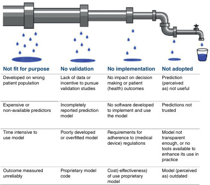

# 8. Papers that report diagnostic or screening tests
> Source attribution: [Source credits](../../SOURCE_CREDITS.md).

## PDF page 128 | printed page 109

### Papers that report diagnostic or screening tests

Chapter 8

Ten suspects in the dock

If you are new to the concept of validating diagnostic tests, and if algebraic explanations (‘let’s call this value x. . .’) leave you cold, the following example may help you. Ten suspects are awaiting trial for murder. Only three of them actually committed a murder; the other seven are innocent of any crime. A jury hears each case and finds six of the suspects guilty of murder. Two of the convicted are true murderers. Four suspects are wrongly imprisoned. One murderer walks free. This information can be expressed in what is known as a two-by-two table (Figure 8.1). Note that the ‘truth’ (i.e. whether or not each suspect really committed a murder) is expressed along the horizontal title row, whereas the jury’s verdict (which may or may not reflect the truth) is expressed down the vertical title row. You should be able to see that these figures, if they are typical, reflect a number of features of this particular jury:

•• This jury correctly identifies two in every three true murderers. •• It correctly acquits three of every seven innocent people. •• If this jury has found a person guilty, there is still only a one in three chance that the person actually committed the murder. •• If this jury found a person innocent, they have a three in four chance of actually being innocent. •• In 5 cases of every 10, the jury gets the verdict right.

These five features constitute, respectively, the sensitivity, specificity, positive predictive value, negative predictive value and accuracy of this jury’s performance. The rest of this chapter considers these five features applied to diagnostic (or screening) tests when compared with a ‘true’ diagnosis or gold standard. Later in this chapter, we introduce a sixth, slightly more complicated

How to Read a Paper: The Basics of Evidence-Based Healthcare, Seventh Edition. Trisha Greenhalgh and Paul Dijkstra. © 2025 John Wiley & Sons Ltd. Published 2025 by John Wiley & Sons Ltd.

## PDF page 129 | printed page 110

True criminal status

Murderer Not murderer

Jury verdict ‘Guilty’

Rightly convicted

Wrongly convicted

2 suspects 4 suspects

1 suspect 3 suspects

‘Innocent’

Wrongly acquitted

Rightly acquitted

Figure 8.1 2 × 2 table showing outcome of trial for 10 suspects accused of murder.

(but very useful), feature of a diagnostic test – the likelihood ratio. (After you have read the rest of this chapter, look back at this section. You should, by then, be able to work out that the likelihood ratio of a positive jury verdict in the above-mentioned example is 1.17, and that of a negative one 0.78. If you can’t, don’t worry – many eminent clinicians have no idea what a likelihood ratio is.)

Chapter 8

Validating diagnostic tests against a gold standard

Let’s consider a urine dipstick test and diabetes, which was the example originally offered in the first edition of this book when urine testing for diabetes was widespread in UK. Urine testing is now out of favour (for good reason) and that’s why the example is still a good one to work through. A middle-aged man had been feeling thirsty and had asked his general practitioner (GP) to be tested for diabetes, which runs in his family. An assistant in his GP’s surgery had asked him to produce a urine specimen and dipped a special stick in it. The stick stayed green, which meant, apparently, that there was no sugar (glucose) in his urine. This, the assistant had said, meant that he did not have diabetes. Is this possible? You should be able to explain to the patient that the test result did not necessarily mean this at all, any more than a ‘not guilty’ verdict necessarily means that someone is innocent of murder. According to the World Health Organization (WHO) and UK National Institute for Health and Care Excellence (NICE), we should suspect a diagnosis of type 2 diabetes ‘if an adult presents with persistent hyperglycaemia that may be accompanied by clinical features’. Typical symptoms of diabetes include thirst, passing large amounts of urine, blurred vision, tiredness. Persistent hyperglycaemia is defined as HbA1c of 48 mmol/mol (6.5%) or more; fasting plasma glucose level of 7 mmol/l or more; or random plasma glucose of 11.1 mmol/l or more in the presence of symptoms or signs of diabetes (although, in a symptomatic

## PDF page 130 | printed page 111

patient, a single HbA1c or fasting plasma glucose level can be used, it is sensible to repeat the tests to confirm the diagnosis of type 2 diabetes) and plasma glucose of 11.1 mmol/l 2 hours after a 75-g oral glucose load (the much-dreaded ‘glucose tolerance test’, where the participant has to glug down every last drop of a sickly glucose drink and wait 2 hours for a blood test) [1–3]. These values must be achieved on two separate occasions if the person has no symptoms but on only one occasion if they have typical symptoms of diabetes (thirst, passing large amounts of urine, etc.). These stringent criteria can be termed the gold standard for diagnosing diabetes. In other words, if you fulfil the WHO/NICE criteria, you can call yourself diabetic, and if you don’t, you can’t (although note that official definitions of what is and isn’t a disease change regularly, and indeed, every time we produce a new edition of this book we have to see whether the ones we have cited have changed in the light of further evidence). The same cannot be said for dipping a stick into a random urine specimen. For one thing, you might have true diabetes but have a high renal threshold; that is, your kidneys conserve glucose much better than most people’s, so your blood glucose level would have to be higher than most people’s for any glucose to appear in your urine. Alternatively, you may be an otherwise normal individual with a low renal threshold, so glucose leaks into your urine even when there isn’t any excess in your blood (this happens, for example, in pregnancy). In fact, as anyone with diabetes will tell you, diabetes is very often associated with a negative test for urine glucose. This is why urine testing, despite the advantages listed in the next paragraph, should generally not be used in either diagnosis or monitoring of diabetes [4]. There are, however, many advantages in using a urine dipstick rather than the full-blown glucose tolerance test to check whether someone might have diabetes. The test is inexpensive, convenient, easy to perform, acceptable to most patients and gives an instant, yes/no result. In real life, people like the person in the above example may decline to take an oral glucose tolerance test, especially if they are self-employed and asked to miss a day’s work for the test, or even to have a blood test. Even if the patient was prepared to go ahead with it, their GP might decide (rightly or wrongly) that their symptoms did not merit the expense of this relatively sophisticated investigation. We hope you can see that even though the urine test cannot say for sure if someone is diabetic, it has something of a practical edge over the gold standard. That, of course, is why some people still use it, especially in low-resource environments. To assess objectively just how useful the urine glucose test for diabetes is, we would need to select a sample of people (say, 100) and do two tests on each of them: the urine test (screening test) and a standard oral glucose tolerance test (gold standard). We could then see, for each person, whether the result of the screening test matched the gold standard. Such an exercise is known as a validation study. We could express the results of the validation

Chapter 8

## PDF page 131 | printed page 112

Result of gold standard test

Disease positive

Disease negative

b + d

a + c

Result of screening test

Test positive True positive False positive

a + b

a

b

c + d

c

d

Test negative False negative True negative

Figure 8.2 2 × 2 table notation for expressing the results of a validation study for a diagnostic or screening test.

Table 8.1 Features of a diagnostic test that can be calculated by comparing it with a gold standard in a validation study

Feature of the test Alternative name Question that the feature addresses Formula (see Figure 8.1)

Sensitivity True positive rate (positive in disease)

How good is this test at picking up people who have the condition?

a/a + c

### Chapter 8

Specificity True negative rate (negative in health)

How good is this test at correctly excluding people without the condition?

d/b + d

Positive predictive value

Post-test probability of a positive test

If a person tests positive, what is the probability that they have the condition?

a/a + b

If a person tests negative, what is the probability that they do not have the condition?

d/c + d

Negative predictive value (NPV)

Indicates the posttest probability of a negative testa

Accuracy – What proportion of all tests have given the correct result (i.e. true positives and true negatives as a proportion of all results)?

a + d/a + b + c + d

Likelihood ratio of a positive test

– How much more likely is positive test to be found in a person with, as opposed to without, the condition?

Sensitivity/ (1 − specificity)

a The post-test probability of a negative test is (1 − NPV).

study in a two-by-two table (also known as a two-by-two matrix), as in Figure 8.2, and calculate various features of the test as in Table 8.1, just as we did for the features of the jury above. If the values for the various features of a test (such as sensitivity and

### Automatic table extraction — verify rendered original

|Col1|Col2|Result of gold standard test|Col4|
|---|---|---|---|
|||**_a _+****_ c_** Disease positive|**_b _+****_ d_** Disease negative|
|**_Result of screening test_**|**_a _+****_ b_** Test positive|**_a_** True positive|**_b_** False positive|
|**_Result of screening test_**|**_c _+****_ d_** Test negative|**_c_** False negative|**_d_** True negative|

[Original table](../../tables/ch008_p0131_1.jpg)

## PDF page 132 | printed page 113

Result of glucose tolerance test

Diabetes positive

Diabetes negative

973 people

27 people

Result of urine test for glucose 13 people

Glucose present True positive False positive

6

7

21

966

987 people

Glucose absent False negative True negative

Figure 8.3 2 × 2 table showing results of a validation study of urine glucose testing for diabetes against the gold standard of glucose tolerance test. Source: based on Andersson et al. [5].

test was valid (see question seven below). The validity of urine testing for glucose in diagnosing diabetes was assessed many years ago by Andersson and colleagues [5], whose data we have used in the example in Figure 8.3. The original study was performed on 3268 participants, of whom 67 either refused to produce a specimen or, for some other reason, were not adequately tested. For simplicity’s sake, we have ignored these irregularities and expressed the results in terms of a denominator (total number tested) of 1000 participants. In actual fact, these data came from an epidemiological survey to detect the prevalence of diabetes in a population; the validation of urine testing was a side issue to the main study. If the validation had been the main aim of the study, the participants selected would have included far more diabetic individuals, as question two below shows [5]. If you look up the original paper, you will also find that the gold standard for diagnosing true diabetes was not the oral glucose tolerance test but a more unconventional series of observations. Nevertheless, the example serves its purpose, as it provides us with some figures to put through the equations listed in the last column of Table 8.1. We can calculate the important features of the urine test for diabetes as follows:

Chapter 8

•• sensitivity = a/(a + c) = 6/27 = 22.2% •• specificity = d/(b + d) = 966/973 = 99.3% •• positive predictive value = a/(a + b) = 6/13 = 46.2% •• negative predictive value = d/(c + d) = 966/987 = 97.9% •• accuracy = (a + d)/(a + b + c + d) = 972/1000 = 97.2% •• likelihood ratio of a positive test = sensitivity/(1 − specificity) = 22.2/0.7 = 32 •• likelihood ratio of a negative test = (1 − sensitivity)/specificity = 77.8/

### Automatic table extraction — verify rendered original

|Col1|Col2|Result of glucose tolerance test|Col4|
|---|---|---|---|
|||**27 people** Diabetes positive|**973 people** Diabetes negative|
|**_Result of urine test_** **_for glucose_**|**13 people** Glucose present|**6** True positive|**7** False positive|
|**_Result of urine test_** **_for glucose_**|**987 people** Glucose absent|**21** False negative|**966** True negative|

[Original table](../../tables/ch008_p0132_1.jpg)

## PDF page 133 | printed page 114

From these features, you can probably see why we should not share the GP assistant’s assurance that the thirsty middle-aged man did not have diabetes. A positive urine glucose test is only 22% sensitive, which means that the test misses nearly four-fifths of people who really do have diabetes. In the presence of classical symptoms and a family history, the patient’s baseline odds (pre-test likelihood) of having the condition are pretty high, and they are only reduced to about four-fifths of this (the negative likelihood ratio, 0.78; see section ‘Likelihood ratios’) after a single negative urine test. In view of his symptoms, this man clearly needs to undergo a more definitive test for diabetes [6]. Note that as the definitions in Table 8.1 show, if the test had been positive the patient would have good reason to be concerned, because even though the test is not very sensitive (i.e. it is not good at picking up people with the disease), it is pretty specific (i.e. it is good at excluding people without the disease). Despite the findings of these studies from over 30 years ago, urine testing to ‘exclude diabetes’ is still common in some (especially low-resource) settings. But the academic argument has long shifted to the question of whether the HbA1c blood test is sufficiently sensitive and specific to serve as a screening test for diabetes [7] and (in a recent meta-analysis by Trisha’s own team) for the intermediate state of ‘pre-diabetes’ [8]. The arguments have become far more complex as epidemiologists have weighed in with evidence on early (subclinical) microvascular damage, but the essential principles of the 2 × 2 matrix and the questions about false positives and false negatives still apply. In short, the test performs very well but it does require a blood test and the costs are not insignificant. Students often get mixed up about the sensitivity/specificity dimension of a test and the positive/negative predictive value dimension. As a rule of thumb, the sensitivity or specificity tells you about the test in general, whereas the predictive value tells you about what a particular test result means for the patient in front of you. Hence, sensitivity and specificity are generally used more by epidemiologists and public health specialists whose day-to-day work involves making decisions about populations. A screening mammogram (breast x-ray) might have an 80% sensitivity and a 90% specificity for detecting breast cancer, which means that the test will pick up 80% of cancers and exclude 90% of women without cancer. But imagine you were a GP or practice nurse and a patient comes to see you for the result of her mammogram. The question she will want answered is (if the test has come back positive), ‘What is the chance that I’ve got cancer?’ or (if it has come back negative) ‘What is the chance that I can now forget about the possibility of cancer?’ Many patients (and far too many health professionals) assume that the negative predictive value of a test is 100% – that is, if the test is ‘normal’ or ‘clear’ they think there is no chance of the

Chapter 8

## PDF page 134 | printed page 115

disease being present – and you only need to read the confessional stories in magazines (‘I was told I had cancer but tests later proved the doctors wrong’) to find examples of people who have assumed that the positive predictive value of a test is 100%.

Ten questions to ask about a paper that claims to validate a diagnostic or screening test

In preparing these tips, we have drawn on Guyatt et al. ’s classic chapter ‘Evaluating diagnostic tests’ [9]. Like many of the checklists in this book, these are no more than pragmatic rules of thumb for the novice critical appraiser. For a much more comprehensive and rigorously developed set of criteria, see the work of the Cochrane Diagnostic Test Accuracy Working Group [10]. Lucas and colleagues have since produced a checklist that is similar but not identical to the questions listed here [11]. If you are interested in comprehensive quality assessment tools of diagnostic and prognostic accuracy studies respectively, you might want to read the QUADAS-2 (A Revised Tool for the Quality Assessment of Diagnostic Accuracy Studies) [12], and QUAPAS (An Adaptation of the QUADAS-2 Tool to Assess Prognostic Accuracy Studies) [13] papers. In addition, the STARD (Standards for Reporting of Diagnostic Accuracy Studies) statement, originally published in 2003 and updated in 2015, was developed ‘to improve the completeness and transparency of reports of diagnostic accuracy studies’ [14].

Chapter 8

Question one: Is this test potentially relevant to my patients and my practice? This is the ‘so what?’ question, which epidemiologists call the utility of the test. Even if this test were 100% valid, accurate and reliable, would it help me? Would it identify a treatable disorder? If so, would I use it in preference to the test I use now? Could I (or my patients or the taxpayer) afford it? Would my patients consent to it? Would it change the probabilities for competing diagnoses sufficiently for me to alter my treatment plan? If the answers to these questions are all ‘no’, you may be able to reject the paper without reading further than the abstract or introduction.

Question two: Has the test been compared with a true gold standard? You need to ask, first, whether the test has been compared with anything at all! Papers have occasionally been published in which nothing has been done except perform the new test on a few dozen participants. This exercise may give a range of possible results for the test, but it certainly does not confirm that the ‘high’ results indicate that target disorder (the disease or risk state that you are interested in) is present or that the ‘low’ results indicate that it isn’t.

## PDF page 135 | printed page 116

Next, you should verify that the ‘gold standard’ test used in the survey merits the term. A good way of assessing a gold standard is to use the ‘so what?’ questions listed earlier. For many conditions, there is no absolute gold standard diagnostic test that will say for certain if it is present or not. Unsurprisingly, these tend to be the very conditions for which new tests are most actively sought! Hence, the authors of such papers may need to develop and justify a combination of criteria against which the new test is to be assessed. One specific point to check is that the test being validated here (or a variant of it) is not being used to contribute to the definition of the gold standard.

Question three: Did this validation study include an appropriate spectrum of participants? If you validated a new test for cholesterol in 100 healthy male medical students, you would not be able to say how the test would perform in women, children, older people, those with diseases that seriously raise the cholesterol level, or even those who had never been to medical school. Although few people would be naive enough to select quite such a biased sample for their validation study, it is surprisingly common for published studies to omit to define the spectrum of participants tested in terms of age, gender, symptoms and/or disease severity and specific eligibility criteria. Defining both the range of participants and the spectrum of disease to be included is essential if the values for the different features of the test are to be worth quoting; that is, if they are to be transferable to other settings. A particular diagnostic test may, conceivably, be more sensitive in female participants than in male participants, or in younger rather than in older participants. For the same reasons, the participants on which any test is verified should include those with both mild and severe disease, treated and untreated and those with different but commonly confused conditions. While the sensitivity and specificity of a test are virtually constant whatever the prevalence of the condition, the positive and negative predictive values are crucially dependent on prevalence. This is why GPs are, often rightly, sceptical of the utility of tests developed exclusively in a secondary care population, where the severity of disease tends to be greater, and why a good diagnostic test (generally used when the patient has some symptoms suggestive of the disease in question) is not necessarily a good screening test (generally used in people without symptoms, who are drawn from a population with a much lower prevalence of the disease).

Chapter 8

Question four: Has work-up (verification) bias been avoided? This is easy to check. It simply means, ‘Did everyone who got the new diagnostic test also get the gold standard, and vice versa?’. We hope you have no problem spotting the potential bias in studies where the gold standard test is

## PDF page 136 | printed page 117

only performed on people who have already tested positive for the test being validated. There are, in addition, a number of more subtle aspects of work-up or verification bias that are beyond the scope of this book but which are covered in specialist statistics textbooks [15].

Question five: Has expectation bias been avoided? Expectation bias occurs when pathologists and others who interpret diagnostic specimens are subconsciously influenced by the knowledge of the particular features of the case (e.g. the presence of chest pain when interpreting an ECG). In the context of validating diagnostic tests against a gold standard, the question means, ‘did the people who interpreted one of the tests know what result the other test had shown on each particular participant?’. As we explained in section ‘Was assessment “blind”?’, all assessments should be ‘blind’; that is, the person interpreting the test should not be given any inkling of what the result is expected to be in any particular case.

Question six: Was the test shown to be reproducible both within and between observers? If the same observer performs the same test on two occasions on a participant whose characteristics have not changed, they will get different results in a proportion of cases. All tests show this feature to some extent, but a test with a reproducibility of 99% is clearly in a different league from one with a reproducibility of 50%. A number of factors that may contribute to the poor reproducibility of a diagnostic test are the technical precision of the equipment, observer variability (e.g. in comparing a colour with a reference chart), arithmetical errors and so on. Look back again at section ‘Was assessment “blind”?’ in Chapter 4 to remind yourself of the problem of interobserver agreement. Given the same result to interpret, two people will agree in only a proportion of cases, generally expressed as the kappa score. If the test in question gives results in terms of numbers (such as the serum cholesterol level in millimole per litre), interobserver agreement is hardly an issue. If, however, the test involves reading x-rays (such as the mammogram example in the section ‘Was assessment “blind”?’ in Chapter 4) or asking a person questions about their drinking habits [16], it is important to confirm that reproducibility between observers is at an acceptable level.

Chapter 8

Question seven: What are the features of the test as derived from this validation study? All these standards could have been met, but the test may still be worthless because the test itself is not valid (i.e. its sensitivity, specificity and other crucial features are too low. That is clearly the case for using urine glucose to

## PDF page 137 | printed page 118

screen for diabetes; see section ‘Ten questions to ask about a paper describing a complex intervention’ in Chapter 7). After all, if a test has a false-negative rate of nearly 80%, it is more likely to mislead the clinician than assist the diagnosis if the target disorder is actually present. There are no absolutes for the validity of a screening test, because what counts as acceptable depends on the condition being screened for. Few of us would quibble about a test for colour blindness that was 95% sensitive and 80% specific, but nobody ever died of colour blindness. The Guthrie heelprick screening test for congenital hypothyroidism, performed on all babies in the UK soon after birth, is over 99% sensitive but has a positive predictive value of only 6% (in other words, it picks up almost all babies with the condition at the expense of a high false-positive rate) [15], and rightly so. It is far more important to pick up every single baby with this treatable condition who would otherwise develop severe mental handicap than to save hundreds of parents the relatively minor stress of a repeat blood test on their baby.

Question eight: Were confidence intervals given for sensitivity, specificity and other features of the test? As section ‘Probability and confidence’ explained, a confidence interval, which can be calculated for virtually every numerical aspect of a set of results, expresses the possible range of results within which the true value will lie. Go back to the jury example at the beginning of this chapter. If they had found just one more murderer not guilty, the sensitivity of their verdict would have gone down from 67% to 33%, and the positive predictive value of the verdict from 33% to 20%. This enormous (and quite unacceptable) sensitivity to a single case decision is because we only validated the jury’s performance on 10 cases. The confidence intervals for the features of this jury are so wide that our computer programme refuses to calculate them! Remember, the larger the sample size, the narrower the confidence interval, so it is particularly important to look for confidence intervals if the paper you are reading reports a study on a relatively small sample. If you would like the formula for calculating confidence intervals for diagnostic test features, see the excellent textbook Statistics with Confidence [16].

Chapter 8

Question nine: Has a sensible ‘normal range’ been derived from these results? If the test gives non-dichotomous (continuous) results. In other words, if it gives a numerical value rather than a yes/no result, someone will have to say at what value the test result will count as abnormal. Many of us have been there with our own blood pressure reading. We want to know if our result is ‘okay’ or not, but the doctor insists on giving us a value such as ‘142/92’.

## PDF page 138 | printed page 119

If 140/90 mmHg were chosen as the cut-off for high blood pressure, we would be placed in the ‘abnormal’ category, even though our risk of problems from our blood pressure is very little different from that of a person with a blood pressure of 138/88 mmHg. Quite sensibly, many practising doctors and nurses advise their patients, ‘Your blood pressure isn’t quite right, but it doesn’t fall into the danger zone. Come back in three months for another check’. Nevertheless, the clinician must at some stage make the decision that this blood pressure needs treating with tablets but this one does not. When and how often to repeat a borderline test is often addressed in guidelines; you might, for example, like to look up the detailed guidance and prevailing controversies on how to measure blood pressure [17]. Defining relative and absolute danger zones for a continuous physiological or pathological variable is a complex science, which should take into account the actual likelihood of the adverse outcome that the proposed treatment aims to prevent. This process is made considerably more objective by the use of likelihood ratios (see section below).

Question ten: Has this test been placed in the context of other potential tests in the diagnostic sequence for the condition? In general, we treat high blood pressure on the basis of the blood pressure reading alone (although as mentioned, guidelines recommend basing management on a series of readings rather than a single value). Compare this with the sequence we use to diagnose stenosis (‘hardening’) of the coronary arteries. First, we select patients with a typical history of effort angina (chest pain on exercise). Next, we usually do a resting ECG, an exercise ECG, and perhaps a radionuclide scan of the heart to look for areas short of oxygen. Most patients only come to a coronary angiogram (the definitive investigation for coronary artery stenosis) after they have produced an abnormal result on these preliminary tests. If you took 100 people off the street and sent them straight for a coronary angiogram, the test might display very different positive and negative predictive values (and even different sensitivity and specificity) than it did in the sicker population on which it was originally validated. This means that the various aspects of validity of the coronary angiogram as a diagnostic test are virtually meaningless unless these figures are expressed in terms of what they contribute to the overall diagnostic work-up.

Chapter 8

Likelihood ratios

Question nine described the problem of defining a normal range for a continuous variable. In such circumstances, it can be preferable to express the test result not as ‘normal’ or ‘abnormal’ but in terms of the actual chances

## PDF page 139 | printed page 120

of a patient having the target disorder if the test result reaches a particular level. Take, for example, the use of the prostate-specific antigen (PSA) test to screen for prostate cancer. Most men will have some detectable PSA in their blood (say, 0.5 ng/ml), and most of those with advanced prostate cancer will have very high levels of PSA (above about 20 ng/ml). But a PSA level of, say, 7.4 ng/ml may be found either in a perfectly normal man or in someone with early cancer. There simply is not a clean cut-off between normal and abnormal [18]. We can, however, use the results of a validation study of the PSA test against a gold standard for prostate cancer (say, a biopsy) to draw up a whole series of 2 × 2 tables. Each table would use a different definition of an abnormal PSA result to classify patients as ‘normal’ or ‘abnormal’. From these tables, we could generate different likelihood ratios associated with a PSA level above each different cut-off point. Then, when faced with a PSA result in the ‘grey zone’, we would at least be able to say, ‘this test has not proved that the patient has prostate cancer, but it has increased [or decreased] the odds of that diagnosis by a factor of x’. In fact, as we mentioned earlier, the PSA test is not a terribly good discriminator between the presence and absence of cancer, whatever cut-off value is used. In other words, there is no value for PSA that gives a particularly high likelihood ratio in cancer detection. The latest advice is to share these uncertainties with the patient and let him decide whether to have the test [18]. Although the likelihood ratio is one of the more complicated aspects of a diagnostic test to calculate, it has enormous practical value, and it is becoming the preferred way of expressing and comparing the usefulness of different tests. The likelihood ratio is a particularly helpful test for ruling a particular diagnosis in or out. For example, if a person enters your consulting room somewhere in the UK with no symptoms at all, you know (on the basis of some rather old epidemiological studies) that they have a 5% chance of having iron-deficiency anaemia, because around one person in 20 in the UK population has this condition. In the language of diagnostic tests, this means that the pre-test probability of anaemia, equivalent to the prevalence of the condition, is 0.05. Now, if you carry out a diagnostic test for anaemia, the serum ferritin level, the result will usually make the diagnosis of anaemia either more or less likely. A moderately reduced serum ferritin level (between 18 and 45 μg/l) has a likelihood ratio of 3, so the chances of a patient with this result having iron-deficiency anaemia is generally calculated as 0.05 × 3 – or 0.15 (15%). This value is known as the post-test probability of the serum ferritin test. (Strictly speaking, likelihood ratios should be used on odds rather than on probabilities, but the simpler method shown here gives a good approximation when the pre-test probability is low. In this example, a pre-test probability of 5% is equal to a

Chapter 8

## PDF page 140 | printed page 121

pre-test odds of 0.05/0.95 or 0.053; a positive test with a likelihood ratio of 3 gives a post-test odds of 0.158, which is equal to a post-test probability of 14%) [19]. Figure 8.4 shows a nomogram adapted by Sackett and colleagues from an original paper by Fagan [20], for working out post-test probabilities when the

Likelihood ratio nomogram

0.1 99

0.2

### B

0.5

95

1

1000 500 200 100 50 20 10 5 2 1 0.5 0.2 0.1 0.05 0.02 0.01 0.005 0.002 0.001

90

2

80

70 60 50 40

### A

5

Chapter 8

10

30

20

20

70 60 50 40 30

10

5

80

2

90

1

### C

0.5

95

0.2

99

0.1

Likelihood ratio

Pre-test probability Post-test probability

Figure 8.4 Using likelihood ratios to calculating the post-test probability of someone being a smoker.

## PDF page 141 | printed page 122

pre-test probability (prevalence) and likelihood ratio for the test are known. The lines A, B and C, drawn from a pre-test probability of 25% (the prevalence of smoking among British adults) are, respectively, the trajectories through likelihood ratios of 15, 100 and 0.015 – three different (and all somewhat old) tests for detecting whether someone is a smoker. Actually, test C detects whether the person is a non-smoker, as a positive result in this test leads to a post-test probability of only 0.5%. In summary, as we said at the beginning of this chapter, you can go a long way with diagnostic tests without referring to likelihood ratios. We avoided them ourselves for years. But if you put aside an afternoon to get to grips with this aspect of clinical epidemiology, we predict that your time will have been well spent.

Clinical prediction models

In the previous section, we took you through a rather heavy-going example of the PSA test and concluded that there is no single, clear-cut value that reliably distinguishes ‘normal’ from ‘abnormal’. This is why the recommended approach to assessing a man’s risk of prostate cancer is a combination of several ‘predictors’, including the overall clinical assessment and a digital rectal examination [18]. More generally, you can probably see why, in general, clinicians tend to use a combination of several different diagnostic tests (including their clinical examination, blood tests, x-rays, etc.) to build up a picture of what is wrong with the patient. While any one test has a fuzzy boundary between normal and abnormal, combining them may sharpen the diagnostic focus. So, for example, a woman who presents with a breast lump tends to be offered three different tests, none of which is especially useful when used in isolation: fine needle aspiration, x-ray (mammogram) and ultrasound [21]. By following large cohorts of patients with particular symptoms and carefully recording the findings of clinical examinations and diagnostic tests in all of them, we can come up with numerical estimates of the chance of a person having (or going on to develop) disease X in the presence of symptom A, physical sign B, diagnostic test C and so on, or any combination of these. Interest in – and research into – clinical prediction rules has been growing rapidly in recent years, partly because the growth of information technology means that very large numbers of patients can be entered onto online databases by clinicians in different centres. Clinical prediction models, therefore, play an increasingly important role in contemporary health care and combine several characteristics related to the patient, disease or treatment to predict a diagnostic (estimate an individual’s probability of a specific health condition – often a disease – being

Chapter 8

## PDF page 142 | printed page 123

currently present) or prognostic (predicting a future occurrence of a specific health outcome over a specific time period) outcome [22–24]. Prediction models in healthcare enhance (shared) decision-making, patient outcomes and resource allocation. The Wells rule to aid the diagnosis of deep venous thrombosis (DVT) is an example of a diagnostic prediction model [25]. Applying this model successfully decreased the number of unnecessary referrals of low-risk primary care patients suspected of DVT to secondary care. In the mental health field, prognostic models have been developed using routine healthcare data to identify children at risk for mental health conditions [26]. However, implementation of prediction models in clinical practice is easier said than done! See Figure 8.5 for examples of reasons for failed prediction model adoption in clinical practice, reproduced from [27]. The TRIPOD (Transparent Reporting of a multivariable prediction model for Individual Prognosis or Diagnosis) statement is a 22-item checklist aiming to improve the reporting of studies developing, validating, or updating a prediction model, whether for diagnostic or prognostic purposes [24,28].

Chapter 8

Not fit for purpose No validation No implementation Not adopted

Developed on wrong patient population Lack of data or incentive to pursue validation studies

No impact on decision making or patient (health) outcomes

Prediction (perceived as) not useful

Expensive or non-available predictors Incompletely reported prediction model

No software developed to implement and use the model

Predictions not trusted

Time intensive to use model Poorly developed or overfitted model Requirements for adherence to (medical device) regulations

Model not transparent enough, or no tools available to enhance its use in practice

Outcome measured unreliably Proprietary model code Cost(-effectiveness) of use proprietary model

Model (perceived as) outdated

Figure 8.5 Leaky prognostic model adoption pipeline. Examples of reasons for failed prediction model adoption in clinical practice. Source: reproduced from van Royen et al. [27] with permission of the European Respiratory Society.

Figure 8.5 Leaky prognostic model adoption pipeline. Examples of reasons for failed prediction model adoption in clinical practice. Source: reproduced from van Royen et al. [27] with permission of the European Respiratory Society.

## PDF page 143 | printed page 124

The PROGRESS (PROGnosis RESearch Strategy) framework classifies prognosis research into four main types of study (see https://www. prognosisresearch.com/progress-framework): (i) overall prognosis research (studies that summarise the average risk of an outcome, such as death, or expected value of an outcome, such as a pain score, among people with the health condition of interest in a particular healthcare setting.) [29]; (ii) prognostic factor research (studies that identify factors whose values or levels are associated with changes in the outcome’s risk or expected value.) [30]; (iii) prognostic model research (studies that develop, validate or assess the impact of a prognostic model to predict an individual’s outcome risk or expected outcome value using combinations of prognostic factors.) [31]; and, (iv) predictors of treatment effect research (studies that identify how to tailor treatment decisions for individual patients according to whether they are likely to benefit from particular treatments) [32]. If you are interested in prognosis research, you might want to read the excellent book by Richard Riley and colleagues [33]. For examples of how clinical prediction rules can help us work through some of the knottiest diagnostic challenges in health care, see these papers: how to predict whether a head-injured child should be sent for a computed tomography (CT) scan, Maguire et al. [34]; whether someone with early arthritis is developing rheumatoid arthritis, Kuriya et al. [35]; and which combinations of tests best predict whether an acutely ill child has anything serious wrong with him or her, Verbakel et al. [36]. A paper in the JAMA series ‘Users’ Guides to the Medical Literature’ addresses clinical prediction rules [37].

Chapter 8

Exercises based on this chapter

1. Think about the last diagnostic test you used on a patient (or, if you prefer, the last one you had yourself). Search the literature for evidence on that test. What is its sensitivity, specificity, positive predictive value and negative predictive value? What is its overall accuracy? Did you interpret the test result as definitive – and have you now changed your mind? 2. Using the results of the previous exercise, design a leaflet or website to explain to patients what your chosen test is and how it might mislead them. 3. Search the literature for a clinical prediction rule on a topic you are

interested in. Would you actually use this rule in practice? If not, why not? Why do you think clinicians are not currently using it? 4. Cardiac screening for athletes is a hot topic in sports medicine, and is

contested. In Italy, everyone who wants to participate in competitive sports must have their heart screened; do you agree with this? If so, what

## PDF page 144 | printed page 125

are the risks and benefits? Are you concerned about overdiagnosis and over-treatment? Would this type of screening be practical in your setting? 5. You may have self-tested for COVID-19 during the pandemic with a

lateral flow test and wondered how accurate such tests are compared with sending a swab to the laboratory for polymerase chain reaction (PCR) testing. Review the paper by Leber et al. ‘Comparing the diagnostic accuracy of point-of-care lateral flow antigen testing for SARS-CoV-2 with RT-PCR in primary care (REAP-2)’ [38]. What is the sensitivity, specificity, positive predictive value and negative predictive value of the point-ofcare lateral flow antigen test? How does the overall accuracy of these two tests compare?

### References

1. National Institute for Health and Care Excellence. When should I suspect type 2 diabetes in adults? Clinical Knowledge Summaries. https://cks.nice.org.uk/topics/ diabetes-type-2/diagnosis/diagnosis-in-adults (accessed 9 September 2023). 2. World Health Organization. Definition and Diagnosis of Diabetes Mellitus and Intermediate Hyperglycaemia: Report of a WHO/IDF consultation. Geneva: WHO; 2006. 3. World Health Organization. Use of Glycated Haemoglobin (Hba1c) in Diagnosis of Diabetes Mellitus: Abbreviated report of a WHO consultation. Geneva: WHO; 2011. 4. Wei OY, Teece S. Urine dipsticks in screening for diabetes mellitus. Emergency Medicine Journal 2006; 23: 138. 5. Andersson D k. g., Lundblad E, Svärdsudd K. A model for early diagnosis of type 2 diabetes mellitus in primary health care. Diabetic Medicine 1993; 10: 167–73. 6. Friderichsen B, Maunsbach M. Glycosuric tests should not be employed in

### Chapter 8

population screenings for NIDDM. Journal of Public Health 1997; 19: 55–60. 7. Lu ZX, Walker KZ, O’Dea K, et al. A1C for screening and diagnosis of type 2

diabetes in routine clinical practice. Diabetes Care 2010; 33: 817–19. 8. Barry E, Roberts S, Oke J, et al. Efficacy and effectiveness of screen and treat

policies in prevention of type 2 diabetes: systematic review and meta-analysis of screening tests and interventions. BMJ 2017; 356: i6538. 9. Guyatt G, Sackett D, Haynes B. Evaluating diagnostic tests. In: Haynes RB, Sackett DL, Guyatt GH, et al., eds. Clinical Epidemiology: How to do clinical practice research. Philadelphia, PA: Lippincott Williams & Wilkins; 2006. 10. Deeks JJ, Bossuyt PM, Leeflang MM, Takwoingi Y (eds). Cochrane Handbook for Systematic Reviews of Diagnostic Test Accuracy. Chichester: Wiley; 2023. 11. Lucas NP, Macaskill P, Irwig L, et al. The development of a quality appraisal tool for studies of diagnostic reliability (QAREL). Journal of Clinical Epidemiology 2010; 63: 854–61.

## PDF page 145 | printed page 126

12. Whiting PF, Rutjes AWS, Westwood ME, et al. QUADAS-2: A revised tool for the quality assessment of diagnostic accuracy studies. Annals of Internal Medicine 2011; 155: 529–36. 13. Lee J, Mulder F, Leeflang M, et al. QUAPAS: An adaptation of the QUADAS-2 tool to assess prognostic accuracy studies. Annals of Internal Medicine 2022; 175: 1010–18. 14. Bossuyt PM, Reitsma JB, Bruns DE, et al. STARD 2015: an updated list of essential items for reporting diagnostic accuracy studies. BMJ 2015; 351: h5527. 15. Lu Y, Dendukuri N, Schiller I, et al. A Bayesian approach to simultaneously adjusting for verification and reference standard bias in diagnostic test studies. Statistics in Medicine. 2010; 29: 2532–43. 16. Altman DG, Machin D, Bryant TN, et al., eds. Statistics with Confidence: Cconfidence intervals and statistical guidelines. 2nd edn. London: BMJ Books; 2011. 17. Stergiou GS, Parati G, McManus RJ, et al. Guidelines for blood pressure

measurement: development over 30 years. Journal of Clinical Hypertension (Greenwich) 2018; 20: 1089–91. 18. Qaseem A, Barry MJ, Denberg TD, et al. Screening for prostate cancer: a guidance statement from the Clinical Guidelines Committee of the American College of Physicians. Annals of Internal Medicine 2013; 158: 761–9. 19. Guyatt GH, Patterson C, Ali M, et al. Diagnosis of iron-deficiency anemia in the elderly. American Journal of Medicine 1990; 88: 205–9. 20. Fagan T. Nomogram for Bayes’s theorem. New England Journal of Medicine. 1975; 293: 257. 21. National Institute for Health and Care Excellence. Breast Cancer. Quality Standard QS12. London: NICE; 2016. https://www.nice.org.uk/Guidance/QS12 (accessed 4 December 2023). 22. Steyerberg EW. Introduction. In: Steyerberg EW, ed. Clinical Prediction Models: A practical approach to development, validation, and updating. Cham, Switzerland: Springer; 2019. pp. 1–11. 23. Smeden M van, Reitsma JB, Riley RD, et al. Clinical prediction models: diagnosis versus prognosis. Journal of Clinical Epidemiology 2021; 132: 142–5. 24. Moons KGM, Altman DG, Reitsma JB, et al. Transparent Reporting of a multivariable prediction model for Individual Prognosis Or Diagnosis (TRIPOD): explanation and Eeaboration. Annals of Internal Medicine 2015; 162: W1. 25. Geersing GJ, Zuithoff NPA, Kearon C, et al. Exclusion of deep vein thrombosis using the Wells rule in clinically important subgroups: individual patient data meta-analysis. BMJ 2014; 348: g1340. 26. Koning NR, Büchner FL, Vermeiren RRJM, et al. Identification of children at risk for mental health problems in primary care: development of a prediction model with routine health care data. eClinicalMedicine 2019; 15: 89–97. 27. van Royen FS, Moons KGM, Geersing G-J, et al. Developing, validating, updating and judging the impact of prognostic models for respiratory diseases. European Respiratory Journal 2022; 60: 2200250.

### Chapter 8

## PDF page 146 | printed page 127

28. Collins GS, Reitsma JB, Altman DG, et al. Transparent reporting of a

multivariable prediction model for individual prognosis or diagnosis (TRIPOD): the TRIPOD statement. BMJ 2015; 350: g7594. 29. Hemingway H, Croft P, Perel P, et al. Prognosis research strategy (PROGRESS) 1: a framework for researching clinical outcomes. BMJ 2013; 346: e5595. 30. Riley RD, Hayden JA, Steyerberg EW, et al. Prognosis Research Strategy (PROGRESS) 2: Prognostic Factor Research. PLOS Medicine 2013; 10: e1001380. 31. Steyerberg EW, Moons KGM, van der Windt DA, et al. Prognosis Research Strategy (PROGRESS) 3: prognostic model research. PLoS Medicine 2013; 10: e1001381. 32. Hingorani AD, van der Windt DA, Riley RD, et al. Prognosis research strategy (PROGRESS) 4: stratified medicine research. BMJ 2013; 346: e5793. 33. Riley RD, van der Windt D, Croft P, eds. Prognosis Research in Healthcare: Concepts, methods, and impact. Oxford: Oxford University Press; 2019. 34. Maguire JL, Boutis K, Uleryk EM, et al. Should a head-injured child receive a head ct scan? A systematic review of clinical prediction rules. Pediatrics 2009; 124: e145–54. 35. Kuriya B, Cheng CK, Chen HM, et al. Validation of a prediction rule for

development of rheumatoid arthritis in patients with early undifferentiated arthritis. Annals of the Rheumatic Diseases 2009; 68: 1482–5. 36. Verbakel JY, Van den Bruel A, Thompson M, et al. How well do clinical prediction rules perform in identifying serious infections in acutely ill children across an international network of ambulatory care datasets? BMC Medicine 2013; 11: 10. 37. Alba AC, Agoritsas T, Walsh M, et al. Discrimination and calibration of clinical prediction models: users’ guides to the medical literature. JAMA 2017; 318: 1377–84. 38. Leber W, Lammel O, Siebenhofer A, et al. Comparing the diagnostic accuracy of point-of-care lateral flow antigen testing for SARS-CoV-2 with RT-PCR in primary care (REAP-2). EClinicalMedicine 2021; 38: 101011.

### Chapter 8
