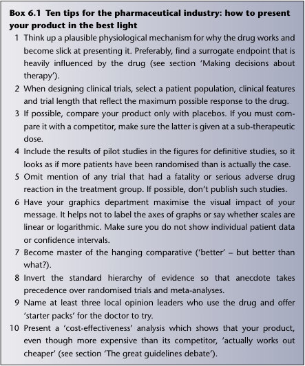
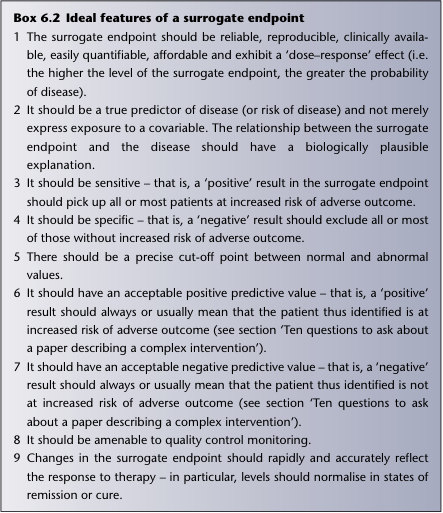

# 6. Papers that report clinical trials of simple interventions
> [Source credits](../../SOURCE_CREDITS.md).

## Study pillars

### What is a clinical trial of a simple intervention?

An evaluation of a well-defined intervention, often comparing it with a control or alternative treatment.

PDF p. 101

### Why examine the comparator in a drug trial?

An inappropriate alternative, dose or schedule can make the new intervention appear more favourable.

PDF p. 106

### Why inspect patient selection in a treatment trial?

The benefit-harm balance may not transfer to patients with different characteristics or comorbidities.

PDF p. 106

## Full source extraction

# 6. Papers that report clinical trials of simple interventions
> Source attribution: [Source credits](../../SOURCE_CREDITS.md).

## PDF page 101 | printed page 82

### Papers that report clinical trials of simple interventions

Chapter 6

What is a clinical trial?

This chapter is about papers that report clinical trials, specifically trials of simple interventions – interventions that are well demarcated (see Chapter 7 to find out about complex interventions, which aren’t). A clinical trial is usually (but not always) a randomised controlled trial (RCT), a key study design that we introduced in Chapter 3 (see section ‘What are randomised controlled trials and why do they matter?’) and explained more about in Chapter 4 (see subsection ‘Sources of bias in randomised controlled trials’). Here, we build on those introductory sections and discuss the most common kind of simple intervention trial, the RCT of drug therapy. We also consider how to make a decision about therapy and the curse of surrogate endpoints. Finally, we introduce the Consolidated Standards of Reporting Trials (CONSORT) statement, which lists what information you should expect to find in a paper reporting an RCT of simple intervention. As mentioned in the introductory sections on RCTs in Chapters 3 and 4, clinical trials compare the effects of one treatment with another. They may involve patients, healthy people, or both [1]. Many clinicians and researchers consider clinical trials to be the gold standard method for evaluation of healthcare interventions, with inherent advantages over non-randomised observational studies [2]. Clinical trials aim to generate high-quality evidence about the most effective treatment or preventative strategy for patients with a specific condition (such as established coronary heart disease) or people with risk factors (such as high serum cholesterol levels) who are at risk of developing a condition in the future. Clinical trials are generally expensive, lengthy and complicated. Unnecessary clinical trials (e.g. ones that repeat definitive studies already in the literature) are therefore wasteful of scarce human and monetary resources (not to mention a waste of everyone’s time, including the patients who volunteer for the study). The first – and probably

How to Read a Paper: The Basics of Evidence-Based Healthcare, Seventh Edition. Trisha Greenhalgh and Paul Dijkstra. © 2025 John Wiley & Sons Ltd. Published 2025 by John Wiley & Sons Ltd.

## PDF page 102 | printed page 83

most important – question you should ask is whether the trial reported in the paper you are reading was really necessary. Did the state of knowledge and uncertainty about the condition actually merit a new trial at the time of this study was commenced?

Drug trials: ‘evidence’ and marketing

If you are a clinical doctor, nurse practitioner or pharmacist (i.e. if you prescribe or dispense drugs), the pharmaceutical and medical devices industries are interested in you, and spend a proportion of their multimillion pound annual advertising budget trying to influence you (Box 6.1); however, as a past editor of the BMJ, Fiona Godlee states in this editorial:

it takes two to tango. It’s time for the profession to take a lead. This means saying no to gifts and hospitality, ensuring that research and clinical collaborations are transparent and unbiased in their design and reporting, refusing to be a guest or ghost author, declining the role of paid opinion leader, paying our way for information and education, and refusing industry support unless it is entirely transparent and in patients’ or the public’s best interests [3].

Chapter 6

Even if you are a mere patient, the industry might, in some countries where it is legal, target you directly through direct-to-consumer advertising (DTCA) [4]. Robert Shmerling has described how DTCA could ‘hook us’; he gives examples of advertising words that should sound alarm bells [5]. When Trisha wrote the first edition of this book in 1995, the standard management of vaginal thrush (Candida infection) was for a doctor to prescribe clotrimazole pessaries. By the time the second edition was published in 2001, these pessaries were available over the counter in pharmacies. For the past 15 years, clotrimazole has been advertised on prime-time TV – thankfully after the nine o’clock watershed – and more recently the manufacturers of this and other powerful drugs are advertising directly to consumers via the Internet and social media [6]. In case you were wondering, such advertising is often biased; for example, it tends to place more emphasis on benefits than risks and it tends to imply that the condition isn’t going to get better on its own [7]. One of the most effective ways of changing the prescribing habits of a clinician is still via a pharmaceutical sales representative (known to most of us in the UK as the ‘drug rep’ and to our North American colleagues as the ‘detailer’), who travels round with a briefcase full of ‘evidence’ in support of their wares [8]. Indeed, as we discuss in more detail in Chapters 14 and 15, the evidence-based medicine movement has learnt a lot from the drug industry in recent years about changing the behaviour of physicians, and now uses

## PDF page 103 | printed page 84

Box 6.1 Ten tips for the pharmaceutical industry: how to present your product in the best light 1 Think up a plausible physiological mechanism for why the drug works and become slick at presenting it. Preferably, find a surrogate endpoint that is heavily influenced by the drug (see section ‘Making decisions about therapy’). 2 When designing clinical trials, select a patient population, clinical features and trial length that reflect the maximum possible response to the drug. 3 If possible, compare your product only with placebos. If you must compare it with a competitor, make sure the latter is given at a sub-therapeutic dose. 4 Include the results of pilot studies in the figures for definitive studies, so it looks as if more patients have been randomised than is actually the case. 5 Omit mention of any trial that had a fatality or serious adverse drug

### Chapter 6

reaction in the treatment group. If possible, don’t publish such studies. 6 Have your graphics department maximise the visual impact of your

message. It helps not to label the axes of graphs or say whether scales are linear or logarithmic. Make sure you do not show individual patient data or confidence intervals. 7 Become master of the hanging comparative (‘better’ – but better than what?). 8 Invert the standard hierarchy of evidence so that anecdote takes

precedence over randomised trials and meta-analyses. 9 Name at least three local opinion leaders who use the drug and offer ‘starter packs’ for the doctor to try. 10 Present a ‘cost-effectiveness’ analysis which shows that your product, even though more expensive than its competitor, ‘actually works out cheaper’ (see section ‘The great guidelines debate’).

the same sophisticated techniques of persuasion in what is known as academic detailing of individual health professionals [9]. Interestingly, DTCA often works by harnessing the persuasive power of the patient, who effectively becomes an unpaid ‘rep’ for the pharmaceutical industry. If you think you’d be able to resist a patient more easily than a real rep, you’re probably wrong – as Becker and Midoun’s systematic review of DTCA in psychiatric conditions showed [10]. Pharmaceutical companies also know the significant DTCA potential of big sport events like the Super Bowl, as Gray and colleagues’ study illustrates [11]. Before you agree to meet a pharmaceutical rep (or when a patient attends with a newspaper article, Internet download or a ChatGPT summary

Unmatched source image; PDF page 103. Consult the original caption.

## PDF page 104 | printed page 85

recommending the drug or device), remind yourself of some basic rules of research design. As Chapter 3 argued, questions about the benefits of therapy should ideally be addressed with RCTs. But preliminary questions about pharmacokinetics (i.e. how the drug behaves while it is getting to its site of action), particularly those relating to bioavailability, require a straight dosing experiment in healthy (and, if ethical and practicable, sick) volunteers. Similarly, a medical device needs to go through a careful design phase to optimise its functionality and usability before being tested in a clinical trial. This is also the case for artificial intelligence (AI) systems as we discuss in the chapter on AI. In relation to drugs, common (and hopefully mild) adverse reactions may be picked up, and their incidence quantified, in the RCTs undertaken to demonstrate efficacy. But rare (and usually more serious) adverse drug reactions require both pharmacovigilance surveys (collection of data prospectively on patients receiving a newly licensed drug) and case–control studies (see section ‘What are cohort studies?’ in Chapter 3) to establish association. Ideally, individual rechallenge experiments (where the patient who has had a reaction considered to be caused by the drug is given the drug again in carefully supervised circumstances) should be performed to establish causation [12]. Pharmaceutical reps do not tell nearly as many lies as they used to (drug marketing has become an altogether more sophisticated science), but as Goldacre [13] has shown in his book Bad Pharma, they probably still provide information that is at best selective and at worst overtly biased. It often helps their case, for example, to present the results of uncontrolled trials and express them in terms of before-and-after differences in a particular outcome measure. Reference to the section ‘What are cross-sectional surveys?’ in Chapter 3 and the literature on placebo effects [14,15] should remind you why uncontrolled before-and-after studies are the stuff of teenage magazines, not hard science. In fact, they are discouraged [16]. The late Dr Andrew Herxheimer, who edited the Drug and Therapeutics Bulletin for many years, undertook a survey of ‘references’ cited in advertisements for pharmaceutical products in the leading UK medical journals. He once told Trisha that a high proportion of such references cite ‘data on file’ and many more refer to publications written, edited and published entirely by the industry. Evidence from these sources has sometimes (although by no means invariably) been shown to be of lower scientific quality than that which appears in independent, peer-reviewed journals. And let’s face it, if you worked for a drug company that had made a major scientific breakthrough, you would probably submit your findings to a publication such as the Lancet or the New England Journal of Medicine

Chapter 6

## PDF page 105 | printed page 86

before publishing them in-house. In other words, you don’t need to ‘trash’ papers about drug trials because of where they have been published, but you do need to look closely at the methods and statistical analysis of such trials.

Making decisions about therapy

Sackett and colleagues [12], in their classic textbook Clinical Epidemiology: A basic science for clinical medicine, argued that before starting a patient on a drug, the doctor should:

1. Identify for this patient the ultimate objective of treatment (cure, prevention of recurrence, limitation of functional disability, prevention of later complications, reassurance, palliation, symptomatic relief, etc.). 2. Select the most appropriate treatment using all available evidence (this includes addressing the question of whether the patient needs to take any drug at all). 3. Specify the treatment target (how will you know when to stop treatment, change its intensity or switch to some other treatment?).

Chapter 6

For example, in the treatment of high blood pressure, the doctor might decide that:

1. the ultimate objective of treatment is to prevent (further) target organ damage to brain, eye, heart, kidney and so on (and thereby prevent serious complications such as stroke and, ultimately, death) 2. the choice of specific treatment is between the various classes of antihypertensive drugs selected on the basis of randomised, placebo-controlled and comparative trials – as well as between non-drug treatments such as salt restriction; and 3. the treatment target might be a phase V diastolic blood pressure (right arm, sitting) of less than 90 mmHg, or as close to that as tolerable in the face of drug adverse effects.

Note that in some situations (e.g. terminal care), the ultimate objective of treatment may not be to prolong life but, whatever it is, it should be stated and the drug regimen organised to achieve it. If Sackett et al.’s three steps are not followed, therapeutic chaos can result. For example, in old (> 74 years) adults, unless your patient has type 2 diabetes, statin treatment will likely not reduce atherosclerotic cardiovascular disease or all-cause mortality [17]. In a veiled slight on surrogate endpoints (see below), Sackett and his team remind us that the choice of specific therapy should be determined by evidence of

## PDF page 106 | printed page 87

what does work, and not on what seems to work or ought to work. ‘Today’s therapy’, they warn, ‘when derived from biologic facts or uncontrolled clinical experience, may become tomorrow’s bad joke’ [12].

Surrogate endpoints

If you are a practising (and non-academic) clinician, your main contact with research papers might not be through peer reviewed journals but through what gets fed to you by industry: ‘industry reps’, DTCA or indeed industrysponsored trials with surrogate endpoints. Industry is a slick player at the surrogate endpoint game, and we make no apology for labouring the point that such outcome measures must be evaluated very carefully. We will define a surrogate endpoint as:

Chapter 6

a variable which is relatively easily measured and which predicts a rare or distant outcome of either a toxic stimulus (e.g. pollutant) or a therapeutic intervention (e.g. drug, surgical procedure, piece of advice), but which is not itself a direct measure of either harm or clinical benefit.

The growing interest in surrogate endpoints in medical research reflects two important features of their use:

•• They can considerably reduce the sample size, duration and, therefore, cost, of clinical trials. •• They can allow treatments to be assessed in situations where the use of primary outcomes would be excessively invasive or unethical.

In the evaluation of pharmaceutical products, commonly used surrogate endpoints include:

•• pharmacokinetic measurements (e.g. concentration–time curves of a drug or its active metabolite in the bloodstream) •• in vitro (i.e. laboratory) measures such as the mean inhibitory concentration of an antimicrobial against a bacterial culture on agar •• macroscopic appearance of tissues (e.g. gastric erosion seen at endoscopy) •• change in levels of (alleged) ‘biological markers of disease’ (e.g. microalbuminuria in the measurement of diabetic kidney disease) •• radiological appearance (e.g. shadowing on a chest x-ray or, in a more

contemporary setting, functional magnetic resonance imaging).

Surrogate endpoints have a number of drawbacks. First and foremost, the surrogate endpoint may not closely reflect the treatment target – in other words, it may not be valid or reliable. Second, a change in the surrogate

## PDF page 107 | printed page 88

endpoint does not itself answer the essential preliminary questions: ‘What is the objective of treatment in this patient?’ and ‘What, according to valid and reliable research studies, is the best available treatment for this condition?’ Third, the use of a surrogate endpoint has the same limitations as the use of any other single measure of the success or failure of therapy – it ignores all the other measures! Over-reliance on a single surrogate endpoint as a measure of therapeutic success usually reflects a narrow or naïve clinical perspective. Finally, surrogate endpoints are often developed in animal models of disease because changes in a specific variable can be measured under controlled conditions in a well-defined population. However, extrapolation of these findings to human disease is liable to be invalid [18], for these reasons:

•• In animal studies, the population being studied has fairly uniform biological characteristics and may be genetically inbred. •• Both the tissue and the disease being studied may vary in important characteristics (e.g. susceptibility to the pathogen, rate of cell replication) from the parallel condition in human subjects. •• The animals are kept in a controlled environment, which minimises the influence of lifestyle variables (e.g. diet, exercise, stress) and concomitant medication. •• Giving high doses of chemicals to experimental animals may distort the usual metabolic pathways and thereby give misleading results. Animal species best suited to serve as a surrogate for humans vary for different chemicals.

Chapter 6

The ideal features of a surrogate endpoint are shown in Box 6.2. If the ‘rep’ who is trying to persuade you about the value of the drug or modality cannot justify the endpoints used, you should challenge them to produce additional evidence [19]. If you are interested in pursuing some real examples of surrogate endpoints that led to misleading practices and recommendations, try these:

•• The controversial granting of accelerated approval by the US Food and Drug Administration (FDA) in June 2021 to aducanumab for treating Alzheimer’s disease, based on a surrogate end point: the drug’s amyloidreducing effects [20]. This was despite evidence that shrinkage of β-amyloid protein plaques does not predictably delay cognitive impairment in patients [21]. As a result of this approval, three advisors to the FDA resigned [22]. In December 2021, the European Medicines Agency (EMA) rejected aducanumab for medical use in the European Union [23]. Biogen has since withdrawn its application for a marketing authorization of aducanumab for the treatment of Alzheimer’s disease [24].

## PDF page 108 | printed page 89

Box 6.2 Ideal features of a surrogate endpoint 1 The surrogate endpoint should be reliable, reproducible, clinically available, easily quantifiable, affordable and exhibit a ‘dose–response’ effect (i.e. the higher the level of the surrogate endpoint, the greater the probability of disease). 2 It should be a true predictor of disease (or risk of disease) and not merely express exposure to a covariable. The relationship between the surrogate endpoint and the disease should have a biologically plausible explanation. 3 It should be sensitive – that is, a ‘positive’ result in the surrogate endpoint should pick up all or most patients at increased risk of adverse outcome. 4 It should be specific – that is, a ‘negative’ result should exclude all or most of those without increased risk of adverse outcome. 5 There should be a precise cut-off point between normal and abnormal values. 6 It should have an acceptable positive predictive value – that is, a ‘positive’ result should always or usually mean that the patient thus identified is at increased risk of adverse outcome (see section ‘Ten questions to ask about a paper describing a complex intervention’). 7 It should have an acceptable negative predictive value – that is, a ‘negative’ result should always or usually mean that the patient thus identified is not at increased risk of adverse outcome (see section ‘Ten questions to ask about a paper describing a complex intervention’). 8 It should be amenable to quality control monitoring. 9 Changes in the surrogate endpoint should rapidly and accurately reflect the response to therapy – in particular, levels should normalise in states of remission or cure.

### Chapter 6

•• A study of a new ‘cure’ for vaginal dryness, whose efficacy was measured in terms of proportion of parabasal cells in the ‘vaginal maturation index’, along with vaginal pH [25]. The parabasal cell index perked up and vaginal pH improved in the intended direction, allowing the researchers to claim that the drug was effective, but in reality the women in the study didn’t feel significantly less dry (we were not surprised to find that the study was funded by the drug’s manufacturer). In another industrysponsored study using the same surrogate endpoints and patient outcome for vaginal dryness, women did feel significantly less dry [26]. Interestingly, the authors argued that the ‘most bothersome symptom’ (MBS; an FDArecommended patient-reported endpoint for clinical trials) ‘may not

Unmatched source image; PDF page 108. Consult the original caption.

## PDF page 109 | printed page 90

adequately evaluate or address the multiple symptoms associated with vulvovaginal atrophy (VVA) in postmenopausal women.’ They continued ‘MBS is a subjective, patient-reported endpoint that may be influenced by a greater placebo effect than more objective endpoints.’ Their ‘objective endpoints’ are actually surrogate endpoints! •• The use of ECG findings instead of clinical outcomes (syncope, death) in deciding the efficacy and safety of anti-arrhythmia drugs [27]. •• The use of albuminuria instead of the overall clinical benefit–harm

balance to evaluate the usefulness of dual renin–angiotensin blockade in hypertension [28,29]. In this example, the intervention was based on a hypothetical argument that blocking the renin–angiotensin pathway at two separate stages would be doubly effective, and the surrogate marker confirmed that this seemed to be the case, but the combination was also doubly effective at producing the potentially fatal adverse effect of hypokalaemia!

Chapter 6

It would be unsporting to suggest that the pharmaceutical industry always develops surrogate endpoints with the deliberate intention of misleading the licensing authorities and health professionals. In early research into HIV and AIDS, for example, a surrogate endpoint (the CD4 count) was used instead of mortality to accelerate the introduction of highly effective anti-HIV drugs into clinical practice, thereby saving thousands of lives [30]. But this rush to ‘save lives’ in potentially fatal diseases can lead to an overuse of surrogate endpoints and premature licensing of dubious drugs, as a balanced review of the use of surrogate endpoints in cancer research showed [31]. Walia and colleagues’ 2022 review warned that oncological drugs approved on the basis of surrogate outcomes that are not associated with clinically meaningful outcomes can cause significant harm to patients [32]. In short, the industry has a vested interest in overstating its case on the strength of these endpoints [13], so use caution when you read a paper whose findings are not based on hard, patient-relevant outcomes. There is currently no guideline for the reporting of RCTs using surrogate endpoints; the SPIRIT/CONSORT-SURROGATE project group aims to change this. They are developing SPIRIT (Standard Protocol Items: Recommendations for Interventional Trials) and CONSORT extensions to improve the reporting of these trials [33]. You can follow their work on the project website [34]. Surrogate endpoints are only one of many ways in which industry-sponsored trials may give a misleading impression of the efficacy of a drug. Other subtle (and not so subtle) influences on research design, such as framing the question in a particular way or selective reporting of findings, have been described in a 2017 Cochrane review of how industry-sponsored trials tend to favour industry products [35].

## PDF page 110 | printed page 91

What information to expect in a paper describing a randomised controlled trial: the CONSORT statement

Drug trials are an example of a ‘simple intervention’; that is, an intervention that is well demarcated (i.e. it’s easy to say what the intervention comprises) and lends itself to an ‘intervention on’ versus ‘intervention off’ research design. In Chapters 3 and 4, we gave some preliminary advice on assessing the methodological quality of research studies. Here’s some more detail. In 1996, an international working group produced a standard checklist, known as CONSORT, for reporting RCTs in medical journals, which has now been updated several times, the latest in 2010 [36].There is now also a CONSORT statement for non-drug treatments [37], for interventions involving AI (CONSORT-AI) [38] and the reporting of harms in randomised trials [39]. Without doubt, the use of such checklists has increased the quality and consistency of reporting of trials in the medical literature [40]. A checklist based on the CONSORT statement is reproduced in Table 6.1. Please do not try to learn this table off by heart (we certainly couldn’t reproduce it ourselves from memory) but do refer to it if you are asked to critically appraise a paper to which it applies or if you are planning on writing up a randomised trial yourself. Incidentally, one important way to reduce bias in drug marketing is to ensure that every trial that is begun is also written up and published [41]. Otherwise, the drug industry (or anyone else with a vested interest) could withhold publication of any trial that did not support their own belief in the efficacy and/or cost-effectiveness of a particular product. Goldacre [13] covers the topic of compulsory trial registration at inception (and the reluctance of some drug companies to comply with it) in his book.

Chapter 6

Getting worthwhile evidence from pharmaceutical representatives

Any doctor who has ever given an audience to a ‘rep’ who is selling a nonsteroidal anti-inflammatory drug will recognise the gastric erosion example. The question to ask them is not ‘what is the incidence of gastric erosion on your drug?’, but ‘what is the incidence of potentially life-threatening gastric bleeding?’. Other questions to ask ‘drug reps’, based on an early article in the Drug and Therapeutics Bulletin [42], are listed here:

1. See representatives only by appointment. Choose to see only those whose product interests you and confine the interview to that product. 2. Take charge of the interview. Do not hear out a rehearsed sales routine but ask directly for the information.

## PDF page 111 | printed page 92

Table 6.1 Checklist for a randomised controlled trial based on the CONSORT statement

Title/abstract Do the title and abstract say how participants were allocated to interventions (e.g. ‘random allocation’, ‘randomised’ or ‘randomly assigned’)?

Introduction Is the scientific background and rationale for the study adequately explained?

Methods

Objectives Were the specific objectives and/or hypothesis to be tested stated explicitly? Participants and setting Does the paper state the eligibility criteria for participants and the settings and locations where the data were collected? Interventions Does the paper give precise details of the intervention(s) and the control intervention(s) and how and when they were administered? Outcomes Have the primary and secondary outcome measures been clearly defined? When applicable, have the methods used to enhance the quality of measurements (e.g. multiple observations, training of assessors) been set out? Sample size How was sample size determined? When applicable, were any interim analyses and/or rules for stopping the study early explained and justified? Blinding (masking) Does the paper state whether or not participants, those administering the interventions and those assessing the outcomes were blinded to group assignment? How was the success of blinding assessed? Statistical methods Were the statistical methods used to compare groups for primary and secondary outcome(s) and any subgroup analyses, appropriate?

### Chapter 6

Details of randomisation

Sequence generation Was the method used to generate the random allocation sequence, including details of any restrictions (e.g. blocking, stratification), clearly described? Allocation concealment Was the method used to implement the random allocation sequence (e.g. numbered containers or central telephone) stated, and was it made clear whether the sequence was concealed until interventions were assigned? Implementation Does the paper say who generated the allocation sequence, who enrolled participants and who assigned participants to their groups?

Results

Flow diagram Is a clear diagram included showing the flow of participants through the trial? This should report, for each group, the numbers of participants randomly assigned, receiving intended treatment, completing the study protocol and analysed for the primary outcome. Protocol deviations Are all deviations from the original study protocol explained and justified? Recruitment dates Have the authors given the date range during which participants were recruited to the study?

## PDF page 112 | printed page 93

Table 6.1 (Continued)

Title/abstract Do the title and abstract say how participants were allocated to interventions (e.g. ‘random allocation’, ‘randomised’ or ‘randomly assigned’)?

Baseline data Are the baseline demographic and clinical characteristics of each group described? Numbers analysed Is the number of participants (denominator) in each group included in each analysis, and is the analysis by ‘intention to treat’? Outcomes and estimation For each primary and secondary outcome, is there a summary of results for each group, and the estimated effect size and its precision (e.g. 95% confidence interval)? Ancillary analyses Are all additional analyses described and justified, including subgroup analyses, both prespecified and exploratory? Adverse events Have the authors reported and discussed all important adverse events?

Chapter 6

Discussion Interpretation Is the interpretation of the results justified, taking into account study hypotheses, sources of potential bias or imprecision and the dangers of multiple comparisons? Generalisability Have the authors made defensible estimate of the generalisability (external validity) of the trial findings?

Source: Reproduced from Schulz et al. [36] with permission of BMJ Publishing Group Ltd.

3. Request independent published evidence from reputable peer-reviewed journals. 4. Do not look at promotional brochures, which often contain unpublished material, misleading graphs and selective quotations. 5. Ignore anecdotal ‘evidence’ such as the fact that a medical celebrity is prescribing the product. 6. Using the ‘STEP’ acronym, ask for evidence in four specific areas:

•• Safety – that is, likelihood of long-term or serious adverse effects caused by the drug (remember that rare but serious adverse reactions to new drugs may be poorly documented). •• Tolerability, which is best measured by comparing the pooled withdrawal rates between the drug and its most significant competitor. •• eEficacy, of which the most relevant dimension is how the product compares with your current favourite. •• Price, which should take into account indirect as well as direct costs (see section ‘Ten questions to ask about an economic analysis’). 7. Evaluate the evidence stringently, paying particular attention to the power (sample size) and methodological quality of clinical trials and the use of surrogate endpoints. Apply the CONSORT checklist (Table 6.1). Do not accept theoretical arguments in the drug’s favour (e.g. ‘longer half life’) without direct evidence that this translates into clinical benefit.

## PDF page 113 | printed page 94

8. Do not accept the newness of a product as an argument for changing to it. Indeed, there are good scientific arguments for doing the opposite. 9. Decline to try the product via starter packs or by participating in small-

scale, uncontrolled ‘research’ studies. 10. Record in writing the content of the interview and return to these notes if the rep requests another audience.

For more sophisticated advice on how to debunk sponsored clinical trial reports that attempt to blind you with statistics, see Montori and colleagues’ helpful users’ guide [43] and (more tangentially but worth noting) Goldacre’s blockbuster on the corporate tricks of ‘big pharma’ [13].

A note on vaccine trials

Chapter 6

Vaccine trials, a form of RCT designed to test the efficacy of a vaccine in preventing disease, have been around for decades, but fast-track vaccine trials (in which a new vaccine is rapidly developed in a race against time during an epidemic or pandemic) came into the spotlight in 2020 with the rapid development of several coronavirus disease 2019 (COVID-19) vaccines which saved millions of lives worldwide. (You can read the story of the Oxford vaccine on the COVID-19 Oxford Vaccine Trial website: https://www. research.ox.ac.uk/area/coronavirus-research/vaccine). In April 2020, the UK Government rapidly set up a Vaccine Taskforce and tasked NHS Digital develop a service for the public to register their interest in participating in COVID-19 vaccine RCTs. This was done through NHS DigiTrials (https:// digital.nhs.uk/services/nhs-digitrials), a digital platform which provides a service to support and accelerate clinical trials, and reduce the effort and cost of developing new drugs and vaccines. Vaccine trials also paved the way for new treatments. The success of mRNA vaccines against COVID-19, for example, has sparked renewed interest in mRNA as a means of delivering therapeutic proteins [44]. But fasttrack vaccines against COVID-19 were not a panacea, and they generated a number of controversies. A detailed discussion of all these controversies is beyond the scope of this book, but we share one here because it illustrates an important basic point about RCTs: that while an experimental trial is a very good way of testing the efficacy of a drug or vaccine, it’s not a rock-solid way of detecting rare harms. This is because RCTs are powered to detect a clinically important difference in efficacy (that is, answering the question ‘How well does the drug or vaccine work?’). They are therefore almost always underpowered to detect a serious adverse effect that happens only once in several thousand patients (in other words, an RCT is less good for answering the question ‘is the drug or vaccine 100% safe?’).

## PDF page 114 | printed page 95

While the benefits of the different vaccines against COVID-19 outweighed the risks of harm in most people, some troubling findings began to appear in 2021: the Oxford/AstraZeneca vaccine became linked to very rare but occasionally serious and even fatal blood clots in young women. This finding was unexpected and puzzling, and had not been suspected, despite several large and well-conducted clinical trials. The mystery was solved by Professor Marie Scully, a consultant haematologist at University College London hospitals, who identified the mechanism for this rare adverse effect – a combination of increased tendency for the blood to clot and low platelets – and a test for it (the PF4 test). Based on an understanding of the underlying mechanism, doctors now know how to diagnose and treat this rare adverse effect. Young people (especially women under the age of 30) in whom the risks of this particular vaccine may outweigh the benefits may now choose to have an alternative vaccine. You can read more about this remarkable story in Bosley [45], Scully et al. [46] and Perry et al. [47]. We discuss the importance of mechanistic evidence further in Chapter 18.

Chapter 6

Exercises based on this chapter

1. Get hold of some advertisements for drugs, from medical journals and in publicly oriented sources (DTCA). What claims are being made for these products? Are the outcomes ‘hard’ or surrogate? Are the claims made to consumers different from those made to doctors? What questions would you ask a drug rep if they were trying to persuade you to prescribe the drug? 2. Using search methods described in Chapter 2, search the literature for evidence on the management of female sexual dysfunction. Look for review articles (especially systematic reviews). What pharmaceutical products are recommended for this condition? What outcomes are measured in studies? To what extent is the efficacy of drugs for female sexual dysfunction attributable to: (a) a placebo effect, and (b) the use of surrogate outcomes? 3. Review the publications on the controversial granting of accelerated approval (by the US FDA in June 2021) to aducanumab for treating Alzheimer’s disease. Can you describe why the surrogate end point, the drug’s amyloid-reducing effects, was problematic? Base your answer on the ideal features of a surrogate end point listed in Box 6.2.

References

1. NHS England. Clinical trials. 2022. https://www.nhs.uk/conditions/clinical-trials (accessed 4 September 2023). 2. National In statute for Health and Care Research. Clinical Trials Guide, version 2. 2019. https://www.nihr.ac.uk/documents/clinical-trials-guide/20595 (accessed 4 September 2023).

## PDF page 115 | printed page 96

3. Godlee F. Doctors, patients, and the drug industry. BMJ 2009; 338: b463. 4. Liang BA, Mackey T. Direct-to-consumer advertising with interactive internet media: global regulation and public health issues. JAMA 2011; 305: 824–5. 5. Shmerling RH. Harvard Health Ad Watch: How direct-to-consumer ads hook us. Harvard Health [blog post]. 3 March 2022. https://www.health.harvard.edu/blog/ harvard-health-ad-watch-what-you-should-know-about-direct-to-consumerads-2019092017848 (accessed 4 September 2023). 6. Mackey TK, Cuomo RE, Liang BA. The rise of digital direct-to-consumer advertising? Comparison of direct-to-consumer advertising expenditure trends from publicly available data sources and global policy implications. BMC Health Services Research 2015; 15: 236. 7. Kaphigst KA, Dejong W, Rudd RE, et al. A content analysis of direct-to-consumer television prescription drug advertisements. Journal of Health Communication 2004; 9: 515–28. 8. Spurling GK, Mansfield PR, Montgomery BD, et al. Information from pharmaceutical companies and the quality, quantity, and cost of physicians’ prescribing: a systematic review. PLoS Medicine 2010; 7: e1000352. 9. O’Brien MA, Rogers S, Jamtvedt G, et al. Educational outreach visits: effects on professional practice and health care outcomes. Cochrane Database of Systematic Reviews 2007(4): CD000409. 10. Becker SJ, Midoun MM. Effects of direct-to-consumer advertising on patient

### Chapter 6

prescription requests and physician prescribing: a systematic review of psychiatryrelevant studies. Journal of Clinical Psychiatry 2016; 77: e1293–300. 11. Gray MP, San-Juan-Rodriguez A, Chen N, et al. Impact of direct-to-consumer drug advertising during the Super Bowl on drug utilization. Research in Social Administrative Pharmacy 2020; 16: 1136–9. 12. Sackett DL, Haynes RB, Tugwell P. Clinical Epidemiology: A basic science for

clinical medicine. Boston, MA: Little Brown; 1985. 13. Goldacre B. Bad Pharma: How medicine is broken, and how we can fix it. London: Fourth Estate; 2013. 14. Tavel ME. The placebo effect: the good, the bad, and the ugly. American Journal of Medicine 2014; 127: 484–8. 15. Howick J, Friedemann C, Tsakok M, et al. are treatments more effective than

placebos? a systematic review and meta-analysis. PLoS One 2013; 8: e62599. 16. Goodacre S. Uncontrolled before-after studies: discouraged by Cochrane and the EMJ. Emergency Medicine Journal 2015; 32: 507–8. 17. Ramos R, Comas-Cufí M, Martí-Lluch R, et al. Statins for primary prevention of cardiovascular events and mortality in old and very old adults with and without type 2 diabetes: retrospective cohort study. BMJ 2018; 362: k3359. 18. Gøtzsche PC, Liberati A, Torri V, et al. Beware of surrogate outcome measures. International Journal of Technology Assessment in Health Care 1996; 12: 238–46. 19. Habibi R, Lexchin J, Mintzes B, et al. Unwarranted claims of drug efficacy in pharmaceutical sales visits: are drugs approved on the basis of surrogate outcomes promoted appropriately? British Journal of Clinical Pharmacology 2017; 83: 2549–56. 20. Dawoud D, Naci H, Ciani O, et al. Raising the bar for using surrogate endpoints in drug regulation and health technology assessment. BMJ 2021; 374: n2191.

## PDF page 116 | printed page 97

21. Ackley SF, Zimmerman SC, Brenowitz WD, et al. Effect of reductions in amyloid levels on cognitive change in randomized trials: instrumental variable metaanalysis. BMJ 2021; 372: n156. 22. Mahase E. Three FDA advisory panel members resign over approval of Alzheimer’s drug. BMJ 2021; 373: n1503. 23. Roxby P. Alzheimer’s drug aducanumab not approved for use in EU. BBC News 17 December 2021. https://www.bbc.com/news/health-59699907 (accessed 11 September 2023). 24. European Medicines Agency. Aduhelm (application withdrawn). 2022. https:// www.ema.europa.eu/en/medicines/human/withdrawn-applications/aduhelm (accessed 11 September 2023). 25. Portman D, Palacios S, Nappi RE, et al. Ospemifene, a non-oestrogen selective oestrogen receptor modulator for the treatment of vaginal dryness associated with postmenopausal vulvar and vaginal atrophy: a randomised, placebo-controlled, phase III trial. Maturitas 2014; 78: 91–8. 26. Archer DF, Goldstein SR, Simon JA, et al. Efficacy and safety of ospemifene in postmenopausal women with moderate-to-severe vaginal dryness: a phase 3, randomized, double-blind, placebo-controlled, multicenter trial. Menopause 2019; 26: 611–21. 27. Connolly SJ. Use and misuse of surrogate outcomes in arrhythmia trials. Circulation 2006; 113: 764–6. 28. Messerli FH, Staessen JA, Zannad F. Of fads, fashion, surrogate endpoints and dual RAS blockade. European Heart Journal 2010; 31: 2205–8. 29. Harel Z, Gilbert C, Wald R, et al. The effect of combination treatment with aliskiren and blockers of the renin-angiotensin system on hyperkalaemia and acute kidney injury: systematic review and meta-analysis. BMJ 2012; 344: e42. 30. Maguire S. Discourse and adoption of innovations: a study of HIV/AIDS

### Chapter 6

treatments. Health Care Management Review 2002; 27: 74. 31. Kemp R, Prasad V. Surrogate endpoints in oncology: when are they acceptable for regulatory and clinical decisions, and are they currently overused? BMC Medicine 2017; 15: 134. 32. Walia A, Haslam A, Prasad V. FDA validation of surrogate endpoints in oncology: 2005–2022. Journal of Cancer Policy 2022; 34: 100364. 33. Ciani O, Manyara AM, Chan A-W, et al. Surrogate endpoints in trials: a call for better reporting. Trials 2022; 23: 991. 34. SPIRIT/CONSORT-SURROGATE reporting group. SPIRIT/CONSORT- SURROGATE Reporting Guidelines for Surrogate Endpoints. Glasgow: Medical Research Council/Chief Scientist Office Social and Public Health Sciences Unit, University of Glasgow. https://www.gla.ac.uk/schools/healthwellbeing/research/ mrccsosocialandpublichealthsciencesunit/programmes/complexity/methodsdevelopment/spirit-consort-surrogate (accessed 11 September 2023). 35. Lundh A, Lexchin J, Mintzes B, et al. Industry sponsorship and research outcome. Cochrane Database of Systematic Reviews. 2017; (2): MR000033. 36. Schulz KF, Altman DG, Moher D, et al. CONSORT 2010 statement: updated guidelines for reporting parallel group randomised trials. BMJ 2010; 340: c332.

## PDF page 117 | printed page 98

37. Boutron I, Altman DG, Moher D, et al. CONSORT Statement for Randomized Trials of Nonpharmacologic Treatments: A 2017 update and a CONSORT extension for nonpharmacologic trial abstracts. Annals of Internal Medicine 2017; 167: 40–7. 38. Liu X, Rivera SC, Moher D, et al. Reporting guidelines for clinical trial reports for interventions involving artificial intelligence: the CONSORT-AI Extension. BMJ 2020; 370: m3164. 39. Junqueira DR, Zorzela L, Golder S, et al. CONSORT Harms 2022 statement, explanation, and elaboration: updated guideline for the reporting of harms in randomised trials. BMJ 2023; 381: e073725. 40. Turner L, Shamseer L, Altman DG, et al. Does use of the CONSORT Statement impact the completeness of reporting of randomised controlled trials published in medical journals? A Cochrane review. Systematic Reviews 2012; 1: 60. 41. Chalmers I, Glasziou P, Godlee F. All trials must be registered and the results published. BMJ 2013; 346: f105. 42. Herxheimer A. Getting good value from drug reps. Drug and Therapeutics Bulletin 1983; 21: 13–15. 43. Montori VM, Jaeschke R, Schünemann HJ, et al. Users’ guide to detecting

### Chapter 6

misleading claims in clinical research reports. BMJ 2004; 329: 1093–6. 44. Rohner E, Yang R, Foo KS, et al. Unlocking the promise of mRNA therapeutics. Nature Biotechnology 2022; 40: 1586–600. 45. Boseley S. How UK doctor linked rare blood-clotting to AstraZeneca Covid jab. The Guardian 13 April 2021. https://www.theguardian.com/society/2021/apr/13/ how-uk-doctor-marie-scully-blood-clotting-link-astrazeneca-covid-jab-universitycollege-london-hospital (accessed 21 February 2024). 46. Scully M, Singh D, Lown R, et al. Pathologic antibodies to platelet factor 4 after ChAdOx1 nCoV-19 vaccination. New England Journal of Medicine 2021; 384: 2202–11. 47. Perry RJ, Tamborska A, Singh B, et al. Cerebral venous thrombosis after

vaccination against COVID-19 in the UK: a multicentre cohort study. Lancet 2021; 398: 1147–56.
