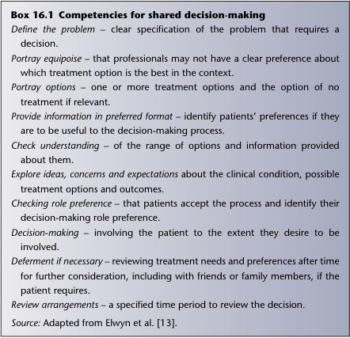
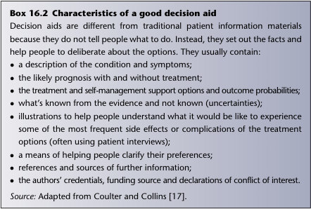

# 16. Applying evidence with patients
> [Source credits](../../SOURCE_CREDITS.md).

## Study pillars

### How do patient narrative and research evidence relate?

They can complement one another: population evidence informs care while the patient's story and clinical judgement give individual meaning.

PDF p. 257

### What are patient-reported outcome measures?

Instruments collecting outcomes directly from patients, intended to capture aspects of health that matter to them.

PDF p. 258

### What does shared decision-making support?

A supported deliberation between clinician and patient about evidence, options, uncertainty and the patient's priorities.

PDF p. 259

## Full source extraction

# 16. Applying evidence with patients
> Source attribution: [Source credits](../../SOURCE_CREDITS.md).

## PDF page 256 | printed page 237

### Applying evidence with patients

Chapter 16

The patient perspective

There is no such thing as the patient perspective, and that is precisely the point of this chapter. At times in our lives, often more frequently the older we get, we are all patients. Some of us are also health professionals, but when the decision relates to our health, our medication, our operation, the adverse effects that we may or may not experience with a particular treatment, we look on that decision differently from when we make the same kind of decision in our professional role. As you will know by now if you have read the earlier chapters of this book, evidence-based healthcare (EBHC) is mainly about using some kind of population average – an odds ratio, a number needed to treat, an estimate of mean effect size, and so on – to inform decisions. But very few of us will behave exactly like the point average on the graph: some will be more susceptible to benefit and some more susceptible to harm from a particular intervention (see Chapter 15 for some genetic reasons for this, but there are also personal, social and cultural reasons). And few of us will value a particular outcome to the same extent as a group average on (say) a standard gamble question (see Chapter 11). The individual unique experience of being ill (or indeed being ‘at risk’ or classified as such) can be expressed in narrative terms: that is, a story can be told about it. And everyone’s story is different. The ‘same’ set of symptoms or piece of news will have a host of different meanings depending on who is experiencing them and what else is going on in their lives. The exercise of taking a history from a patient is an attempt to ‘tame’ this unique set of personal experiences and put it into a more or less standard format to align with the protocols for assessing, treating and preventing disease. Indeed, England’s first professor of general practice, Marshall Marinker, once said

How to Read a Paper: The Basics of Evidence-Based Healthcare, Seventh Edition. Trisha Greenhalgh and Paul Dijkstra. © 2025 John Wiley & Sons Ltd. Published 2025 by John Wiley & Sons Ltd.

## PDF page 257 | printed page 238

that the role of medicine is to distinguish the clear message of the disease from the interfering noise of the patient as a person. As Trisha has written elsewhere, an ‘evidence-based’ perspective on disease and the patient’s unique perspective on their illness (‘narrative-based medicine’, if you like) are not at all incompatible [1]. It is worth going back to the original definition of evidence-based medicine (EBM) proposed by Sackett and colleagues. This definition is reproduced in full, although only the first sentence is generally quoted:

Chapter 16

Evidence based medicine is the conscientious, explicit, and judicious use of current best evidence in making decisions about the care of individual patients. The practice of evidence based medicine means integrating individual clinical expertise with the best available external clinical evidence from systematic research. By individual clinical expertise we mean the proficiency and judgment that individual clinicians acquire through clinical experience and clinical practice. Increased expertise is reflected in many ways, but especially in more effective and efficient diagnosis and in the more thoughtful identification and compassionate use of individual patients’ predicaments, rights, and preferences in making clinical decisions about their care. By best available external clinical evidence we mean clinically relevant research, often from the basic sciences of medicine, but especially from patient centred clinical research into the accuracy and precision of diagnostic tests (including the clinical examination), the power of prognostic markers, and the efficacy and safety of therapeutic, rehabilitative, and preventive regimens (p. 71) [2].

Thus, while the original protagonists of EBM are sometimes wrongly depicted as having airbrushed the poor patient out of the script, they were actually very careful to depict EBM/EBHC as being contingent on patient choice (and also dependent on clinical judgement, but that’s a subject for another day). The ‘best’ treatment is not necessarily the one shown to be most efficacious in randomised controlled trials but the one that fits a particular set of individual circumstances and aligns with the patient’s preferences and priorities. The ‘evidence-based’ approach is sometimes stereotypically depicted by the clinician who feels, for example, that every patient with a high cholesterol level should take a statin because trials have shown these drugs, on average, prevent significant numbers of cardiovascular events in people at a certain level of risk, whether or not the patients say they don’t want to take tablets, can’t face the adverse effects or don’t feel that attending for regular blood tests to monitor the impact is worth the inconvenience.

## PDF page 258 | printed page 239

Almost all research in the EBM tradition between 1990 and 2010 focused on the epidemiological component and sought to build an evidence base of randomised controlled trials and other ‘methodologically robust’ research designs. Later, a tradition of ‘evidence-based patient choice’ emerged in which the patient’s right to choose the option most appropriate and acceptable to them was formalised and systematically studied [3]. The third component of EBM referred to in the above quote – individual clinical judgement – has not been extensively theorised by scholars within the EBM tradition, but if interested, see Greenhalgh [4].

Chapter 16

Patient-reported outcome measures

Before we get into how to involve patients in individualising the decisions of EBHC, we need to introduce an approach for selecting the outcome measures used in clinical trials: patient-reported outcome measures or PROMs. Here’s a definition:

PROMs are the tools we use to gain insight from the perspective of the patient into how aspects of their health and the impact the disease and its treatment are perceived to be having on their lifestyle and subsequently their quality of life (QoL). They are typically self-completed questionnaires, which can be completed by a patient or individual about themselves, or by others on their behalf [5].

By ‘outcome measure’ we mean the aspect of health or illness that researchers (perhaps in consultation with patients) choose to measure to demonstrate (say) whether a treatment has been effective. Death is an outcome measure. So is blood pressure (although it’s a surrogate measure; see Chapter 6). So is the chance of leaving hospital with a live baby when you go into hospital in labour. So is the ability to walk upstairs or make a cup of tea on your own. The point is that in any study the researchers have to define what it is they are trying to influence. PROMs are not individualised measures. On the contrary, they are still a form of population average but, unlike most outcome measures, they are an average of what matters most to patients rather than an average of what researchers or clinicians felt they ought to measure. The way to develop a PROM is to undertake an extensive phase of qualitative research (see Chapter 12) with a representative sample of people who have the condition you are interested in, analyse the qualitative data and then use it to design a survey instrument (‘questionnaire’, see Chapter 13) that captures all the key features of what patients are concerned about [6]. PROMs were first popularised by a team in Oxford led by Ray Fitzpatrick, who used the concept to develop measures for assessing the success of hip

## PDF page 259 | printed page 240

and knee replacement surgery [7]. They are now used fairly routinely in many clinical topics in the wider field of ‘outcomes research’; a review by Kate Churruca and colleagues summarises the evidence on PROMs and discusses the pros and cons of generic PROMS such as the EQ-5D tool (which you can use for any condition) versus disease-specific PROMS [8]. The Journal of the American Medical Association has published a set of standards for PROMs [9]. PROMs are important for all conditions, but they may be particularly important for those which do not have a biomarker (e.g. blood test) that reliably monitors its progress. We can diagnose and monitor diabetes using the HbA1c test, for example, but at the time of writing there is no equivalent biomarker for diagnosing and monitoring long covid, although there are PROMs [10].

Chapter 16

Shared decision-making

Important though PROMs are, they only tell us what patients, on average, value most, not what the patient in front of us values most. To find that out, as we said back in Chapter 1, you would have to ask the patient. And there is now a science and a methodology for ‘asking the patient’ [3,11]. The science of shared decision-making began in the late 1990s as a quirky interest of some keen academic GPs, notably Glyn Elwyn and Adrian Edwards [12]. The idea is based on the notion of the patient as a rational chooser, able and willing (perhaps with support) to join in the deliberation over options and make an informed choice. One challenge is maintaining equipoise; that is, holding back on what you feel the course of action should be and setting out the different options with the pros and cons presented objectively, so the patients can make their own decisions [13]. Box 16.1 lists the competencies that clinicians need to practise shared decision-making with their patients. The various instruments and tools to support shared decision-making have evolved over the years. At the very least, a decision aid would have a way of making the rather dry information of EBHC more accessible to a non-expert, for example by turning numerical data into diagrams and pictures. An example, shown in Figure 16.1, uses colours and simple icons to convey quantitative estimates of risk [14,15]. The ways of measuring the extent to which patients have been involved in a decision have also evolved [16]. Coulter and Collins [17] have produced an excellent guide called Making Shared Decision-Making a Reality, which sets out the characteristics of a really good decision aid (Box 16.2). Increasingly commonly, decision aids are available online, allowing the patient to click through different steps in the decision algorithm (with or

## PDF page 260 | printed page 241

Box 16.1 Competencies for shared decision-making Define the problem – clear specification of the problem that requires a decision. Portray equipoise – that professionals may not have a clear preference about which treatment option is the best in the context. Portray options – one or more treatment options and the option of no

### Chapter 16

treatment if relevant. Provide information in preferred format – identify patients’ preferences if they are to be useful to the decision-making process. Check understanding – of the range of options and information provided about them. Explore ideas, concerns and expectations about the clinical condition, possible treatment options and outcomes. Checking role preference – that patients accept the process and identify their decision-making role preference. Decision-making – involving the patient to the extent they desire to be involved. Deferment if necessary – reviewing treatment needs and preferences after time for further consideration, including with friends or family members, if the patient requires. Review arrangements – a specified time period to review the decision.

Source: Adapted from Elwyn et al. [13].

without support from a health professional). The best way to get your head round shared decision-making tools is to take a look at a few and, if possible, put them to use in practice. The English National Health Service has a website with links to tools for sharing decisions, from abdominal aortic aneurysm repair to stroke prevention in atrial fibrillation (see https://www. england.nhs.uk/personalisedcare/shared-decision-making/decisionsupport-tools). A similar (and more comprehensive) range of decision tools is available from the Ottawa Hospital in Canada (http://decisionaid.ohri.ca/ AZinvent.php). Dr Julian Treadwell, a GP and ex-PhD student of Trisha’s, developed a website called GP Evidence (https://gpevidence.org), which provides decision tools for general practitioners. Each clinical condition has an infographic similar to the one in Figure 16.1, with green smiley faces and red sad ones, to use in conversations with patients. The website is intended for clinicians but it is publicly accessible so there is no reason why patients shouldn’t take a peek at it themselves.

Unmatched source image; PDF page 260. Consult the original caption.

## PDF page 261 | printed page 242

1. What is my risk of having a heart attack in the next 10 years? 2. What are the downsides of taking statins (cholesterol pill)?

The risk for 100 people like you who DO NOT take statins

• Statins need to be taken every day for a long time (maybe forever) • Statins cost money (to you or your drug plan) • Common side effects: nausea, diarrhoea, constipation (most patients can tolerate) • Muscle aching/stiffness: 5 in 100 patients (some need to stop statins because of this) • Liver blood test goes up (no pain, no permanent liver damage): 2 in 100 patients (some need to stop statins because of this) • Muscle and kidney damage: 1 in 20 000 patients requires patients to stop statins)

### NO STATIN

80 people DO NOT have a heart attack (grey, happy)

### Chapter 16

20 people DO have a heart attack (grey, sad)

The risk for 100 people like you who DO take statins

### YES STATIN

80 people still DO NOT have a heart attack (grey, happy)

3. What do you want to do now?

Take (or continue to take) statins

5 people AVOIDED heart attack (white, happy)

Not take (or stop taking) statins

Prefer to decide at some other time

15 people still DO have a heart attack (grey, sad)

95 people experienced NO BENEFIT from taking statins

Had a heart attack

Avoided a heart attack Didn’t have a heart attack

Figure 16.1 Example of a decision aid: choosing statin in a diabetes patient with a 20% risk of myocardial infarction. Source: adapted from Stiggelbout et al. [15].

Box 16.2 Characteristics of a good decision aid Decision aids are different from traditional patient information materials because they do not tell people what to do. Instead, they set out the facts and help people to deliberate about the options. They usually contain:

• • a description of the condition and symptoms;

• • the likely prognosis with and without treatment;

•• the treatment and self-management support options and outcome probabilities; • • what’s known from the evidence and not known (uncertainties);

• • illustrations to help people understand what it would be like to experience some of the most frequent side effects or complications of the treatment options (often using patient interviews); • • a means of helping people clarify their preferences;

• • references and sources of further information;

•• the authors’ credentials, funding source and declarations of conflict of interest.

Source: Adapted from Coulter and Collins [17].

Unmatched source image; PDF page 261. Consult the original caption.

## PDF page 262 | printed page 243

Option grids

These days, most health professionals are (allegedly) keen to share decisions with patients in principle, but qualitative and questionnaire research has shown that they perceive a number of barriers to doing so in practice, including time constraints, lack of applicability of the decision support model to the unique predicament of a particular patient, a perception that they are already sharing decisions in routine consultation talk, and because they feel that patients do not wish to be involved in this way [19]. The reality of a typical general practice consultation, for example, is a long way from the objective reality of a formal decision algorithm. When a patient attends with symptoms suggestive of (say) sciatica, the doctor has 10 minutes to make progress. Typically, they will examine the patient, order some tests and then have a rather blurry conversation about how (on the one hand) the patient’s symptoms might resolve with physiotherapy but (on the other hand) they might like to see a specialist because some cases will need an operation. The patient typically expresses a vague preference for either conservative or interventionist management, and the doctor (respecting the ‘empowered’ views) goes along with the patient’s preference. If the doctor is committed to evidence-based shared decision-making, they may try using a more structured approach; for example, by logging on to an online algorithm or by using pie charts or preprogrammed spreadsheets to elicit numerical scores of how much the patient values particular procedures and outcomes vis à vis one another. But, very often, such tools will have been tried once or twice and then abandoned as technocratic, timeconsuming, overly quantitative and oddly disengaged from the unique personal illness narrative that fills the consultation. The good news is that our colleagues working in the field of shared decision-making have recently acknowledged that the perfect may be the enemy of the good. Most discussions about management options in clinical practice do not require – and may even be thrown off kilter by – an exhaustive analysis of probabilities, risks and preference scores. What most people want is a brief but balanced list of the options, setting out the costs and benefits of each and including an answer to the question ‘what would happen if I went down this route?’. Enter the option grid (see the examples in My Health Decisions: https:// www.ebsco.com/health-care/products/my-health-decisions), which is the product of a collaborative initiative between patients, doctors and academics [19]. An option grid is usually a one-page table covering a single topic. The grids list the different options as columns (COVID-19 vaccine options, for example), with each row answering a different question (such as ‘Should I get a booster?’, ‘How soon would I feel better?’ and ‘How would this treatment

Chapter 16

## PDF page 263 | printed page 244

affect my ability to work?’). An example relating to the question of whether to have the PSA (prostate specific antigen) test for prostate cancer is shown in Figure 16.2. Option grids are developed in a similar way to PROMs, but there is often more of a focus on involvement of the multidisciplinary clinical team, as in the example of an option grid for head and neck cancer management from Elwyn et al. [20]. The distinguishing feature of the option grid approach is that it promotes and supports what has been termed option talk; that is, the discussions and deliberations around the different options. The grids are, in effect, analogue rather than digital in design. The information in an option grid is presented in a format that allows both reflection and dialogue. The grid can be printed off (or the patient can be given the URL) and invited to go away and consider the options before returning for a further consultation. And unlike the previous generation of shared decisionmaking tools, neither the patient nor the clinician needs to be a geek to use them.

Chapter 16

n-of-1 trials and other individualised approaches

The last approach to involving patients that we want to introduce in this chapter is the n-of-1 trial. This is a very simple design in which each participant receives, in randomly allocated order, both the intervention and the control treatment [21]. An example is probably the best way to explain this approach. Back in 1994, some Australian general practitioners wanted to address the clinical issue of which painkiller to use in osteoarthritis [22]. Some patients, they felt, did fine on paracetamol (which has relatively few adverse effects), while others did not respond so well to paracetamol but obtained great relief from a non-steroidal anti-inflammatory drug (NSAID). In the normal clinical setting, one might try paracetamol first and move to the NSAID if the patient did not respond. But supposing there was a strong placebo effect? The patient might conceivably have limited confidence in paracetamol because it is such a commonplace drug, whereas an NSAID in a fancy package might be subconsciously favoured. The idea of the n-of-1 trial is that all treatments are anonymised, prepared in identical formulations and packaging, and just labelled ‘A’, ‘B’ and so on. The participants do not know which drug they are taking, hence their response is not influenced by whether they ‘believe in’ the treatment. To add to scientific rigour, the drugs may be taken in sequence such as ABAB or AABB, with ‘washout’ periods in between. March and colleagues’ n-of-1 trial of paracetamol versus NSAIDs did confirm the clinical hunch that some patients did markedly better on the NSAID but many did equally well on paracetamol. Importantly, unlike a standard

## PDF page 264 | printed page 245

### Prostate Specific Antigen (PSA) Test: Yes or No?

The prostate-specific antigen (PSA) test looks for signs of prostate cancer in

your blood. Use this decision aid to help you and your healthcare

team decide whether or not to have a PSA test. Men usually consider this

test when they are between 55 and 69 years old. Men of black race may

have different risks.

Patient questions

Having a PSA test Not having a PSA test

What does the test involve?

This blood test measures the level of prostate specific antigen (PSA) in your blood. Discuss costs.

No blood test is done.

Does a high PSA level mean I have cancer?

High PSA levels can be due to many reasons, including infection. To check for cancer, you will likely have a sample taken from your prostate gland (a prostate biopsy).

You will not know your PSA level.

Does a normal PSA test mean I do not have cancer?

No, about 15 out of 100 men (15%) with a normal PSA level will have prostate cancer sometime in the next 15 years.

You will not know your PSA level.

How many men will die from prostate cancer?

Up to 6 out of 1,000 men (0.6%) will die from prostate cancer sometime in the next 15 years.

Up to 7 out of 1,000 men (0.7%) will die from prostate cancer sometime in the next 15 years.

What are the benefits?

Benefits are uncertain. You may be the 1 man in 1,000 (0.1%) who avoids death from prostate cancer.

You will avoid biopsies, having prostate cancer treatment, and the risks that come with having treatment.

What are the risks?

If your PSA level is high, you will likely have an outpatient prostate biopsy. About 3 out of 100 men (3%) will have a cancer that causes worry, but is unlikely to cause problems. Biopsies and treatments have risks.

You could be the 1 man in 1,000 (0.1%) who might have avoided death from prostate cancer sometime in the next 15 years.

What are the risks of a prostate biopsy?

Most men have pain or bleeding for a few days after a biopsy. Out of 100 men: • 9 (9%) have infection including 1 (1%) needing emergency care • 7 (7%) have serious bleeding • 3 (3%) have problems peeing • 3 (3%) stay in the hospital for a problem after a biopsy

You will avoid the risks of having a prostate biopsy.

What are the risks (if testing leads to treatment of prostate cancer)?

Out of 100 men treated for prostate cancer: • more than 60 (60%) will have problems with erections • about 20 (20%) will leak pee

Out of 100 men not treated for prostate cancer: • up to 47 (47%) will have problems with erections • about 10 (10%) will leak pee

### Figure 16.2 Example of an option grid. Source: reproduced with permission of Glyn Elwyn.

## PDF page 265 | printed page 246

randomised trial, the n-of-1 design allowed the researchers to identify which patients were in each category. But the withdrawal rate from the trial was high, partly because when participants found a medication that worked, they just wanted to keep taking it rather than swap to the alternative! But despite its conceptual elegance and a distant promise of linking to the ‘personalised medicine’ paradigm in which every patient will have their tests and treatment options individualised to their particular genome, physiome, microbiome and so on, the n-of-1 trial has not caught on widely in either research or clinical practice. A review article by Lillie and colleagues [23] suggests why. Such trials are labour intensive to carry out, requiring a high degree of individual personalisation and large amounts of data for every participant. ‘Washout’ periods raise practical and ethical problems (does one have to endure one’s arthritis with no pain relief for several weeks to serve the scientific endeavour?). Combining the findings from different participants raises statistical challenges. And the (conceptually simple) science of n-of-1 trials has begun to get muddled up with the much more complex and uncertain science of personalised medicine. In short, the n-of-1 trial is a useful design (and one you may be asked about in exams!), but it is not the panacea it was once predicted to be. If you do an n-of-1 trial yourself, don’t forget to consult the CENT (CONSORT Extension for N-of-1 trials) publication guidelines when writing it up [24]. A (somewhat untested) alternative approach to individualising treatment regimens has been proposed by Moore and colleagues [25] in relation to pain relief. Their basic argument is that we should ‘expect failure’ (because the number needed to treat for many interventions is more than 2, statistically speaking any individual is more likely not to benefit than benefit) but ‘pursue success’ (because the ‘average’ for any intervention response masks a subgroup of responders who will do very well on that intervention). They propose a process of guided trial and error, systematically trying one intervention followed by another, until the one that works effectively for this patient is identified. Many front-line clinicians would probably agree with this strategy!

Chapter 16

Exercises based on this chapter

1. Hallux valgus (usually known as bunion) surgery is widely undertaken but produces mixed results, with up to one-third of patients wishing they’d never had it done. Search the PubMed database for the paper by Schrier et al., which reports a systematic review of outcome measures for hallux valgus surgery [26]. List all the different outcome measures and explore how they were developed. How many of these measures are actually based on outcomes that patients themselves value? Which outcome measure

## PDF page 266 | printed page 247

2. Take a look at the paper by Macfarlane and Greenhalgh (which, in the interests of full disclosure, was written by Trisha’s son Al Macfarlane, at the time a newly qualified doctor, with some help from mum) [27]. Al was interested in the recent introduction of a ‘ban’ on prescribing the antiepileptic drug sodium valproate in women who are (or could become) pregnant. The ‘ban’ was not absolute, since it was recognised that, in certain difficult cases, valproate might be the only drug that would control the woman’s epilepsy or mental health condition. Al and Trish felt that since valproate has both benefits and potential harms, shared decisionmaking using an option grid should be used to weigh up the pros and cons. When you have read the evidence in the paper, look carefully at our option grid. Do you think this grid will help or hinder productive conversations between women and their doctors? Do you agree that the woman has a right (and perhaps a duty) to join in the decision? 3. Hunt out the review article by Marwick et al. [28], which searched over 4000 studies and found a mere six n-of-1 trials in patients with schizophrenia. What were the main flaws identified in those studies? Why did the authors think so few n-of-1 studies had been undertaken? Can you find any more such studies published since the review came out (hint: use citation chaining by putting the title into Google Scholar and identifying the studies that cited it)?

Chapter 16

References

1. Greenhalgh T. Narrative based medicine: narrative based medicine in an evidence based world. BMJ 1999; 318: 323. 2. Sackett DL, Rosenberg WM, Gray JM, et al. Evidence based medicine: what it is and what it isn’t. BMJ 1996; 312: 71–2. 3. Edwards A, Elwyn G. Shared Decision-Making in Health Care: Achieving

evidence-based patient choice. New York, NY: Oxford University Press; 2009. 4. Greenhalgh T. Uncertainty and clinical method. In: Sommers LS, Lauiner J (eds). Clinical Uncertainty in Primary Care. Berlin: Springer Nature; 2013. pp. 23–45. 5. Meadows KA. Patient-reported outcome measures: an overview. British Journal of Community Nursing 2011; 16: 146–51. 6. Ader DN. Developing the patient-reported outcomes measurement information system (PROMIS). Medical Care 2007; 45(5): S1–2. 7. Dawson J, Fitzpatrick R, Murray D, et al. Questionnaire on the perceptions of patients about total knee replacement. Journal of Bone and Joint Surgery 1998; 80: 63–9. 8. Churruca K, Pomare C, Ellis LA, et al. Patient-reported outcome measures (PROMs): a review of generic and condition-specific measures and a discussion of trends and issues. Health Expectations 2021; 24: 1015–24. 9. Basch E. Standards for patient-reported outcome-based performance measures standards for patient-reported outcome-based performance measures view-point.

## PDF page 267 | printed page 248

10. Sivan M, Wright S, Hughes S, Calvert M. Using condition specific patient reported outcome measures for long covid. BMJ 2022; 376: o257. 11. Makoul G, Clayman ML. An integrative model of shared decision making in

medical encounters. Patient Education and Counseling 2006; 60: 301–12. 12. Elwyn G, Edwards A, Kinnersley P. Shared decision-making in primary care: the neglected second half of the consultation. British Journal of General Practice 1999; 49: 477–82. 13. Elwyn G, Edwards A, Kinnersley P, et al. Shared decision making and the concept of equipoise: the competences of involving patients in healthcare choices. British Journal of General Practice 2000; 50: 892–9. 14. Edwards A, Elwyn G, Mulley A. Explaining risks: turning numerical data into meaningful pictures. BMJ 2002; 324: 827. 15. Stiggelbout A, Weijden T, Wit MD, et al. Shared decision making: really putting patients at the centre of healthcare. BMJ 2012; 344: e256. 16. Elwyn G, Hutchings H, Edwards A, et al. The OPTION scale: measuring the extent that clinicians involve patients in decision-making tasks. Health Expectations 2005; 8: 34–42. 17. Coulter A, Collins A. Making Shared Decision-Making a Reality. No decision about me, without me. London: King’s Fund; 2011. 18. Elwyn G, Rix A, Holt T, et al. Why do clinicians not refer patients to online decision support tools? Interviews with front line clinics in the NHS. BMJ Open 2012; 2(6): e001530. 19. Elwyn G, Lloyd A, Joseph-Williams N, et al. Option grids: shared decision making made easier. Patient Education and Counseling 2013; 90: 207–12. 20. Elwyn G, Lloyd A, Williams NJ, et al. Shared decision-making in a multidisciplinary head and neck cancer team: a case study of developing option grids. International Journal of Person Centered Medicine 2012; 2: 421–6. 21. Mirza RD, Punja S, Vohra S, Guyatt G. The history and development of N-of-1 trials. Journal of the Royal Society of Medicine 2017; 110: 330–40. 22. March L, Irwig L, Schwarz J, et al. n-of-1 trials comparing a non-steroidal

### Chapter 16

anti-inflammatory drug with paracetamol in osteoarthritis. BMJ 1994; 309: 1041–6. 23. Lillie EO, Patay B, Diamant J, et al. The n-of-1 clinical trial: the ultimate strategy for individualizing medicine? Personalized Medicine 2011; 8: 161–73. 24. Vohra S, Shamseer L, Sampson M, et al.; CENT group. CONSORT extension for reporting N-of-1 trials (CENT) 2015 statement. BMJ 2015; 350: h1738. 25. Moore A, Derry S, Eccleston C, et al. Expect analgesic failure; pursue analgesic success. BMJ 2013; 346: f2690. 26. Schrier JC, Palmen LN, Verheyen CC, et al. Patient-reported outcome measures in hallux valgus surgery. A review of literature. Foot and Ankle Surgery 2015; 21: 11–15. 27. Macfarlane A, Greenhalgh T. Sodium valproate in pregnancy: what are the risks and should we use a shared decision-making approach? BMC Pregnancy and Childbirth 2018; 18: 200. 28. Marwick KF, Stevenson AJ, Davies C, Lawrie SM. Application of n-of-1 treatment trials in schizophrenia: systematic review. British Journal of Psychiatry 2018; 213: 398–403 (erratum in British Journal of Psychiatry 2018; 213: 502).
